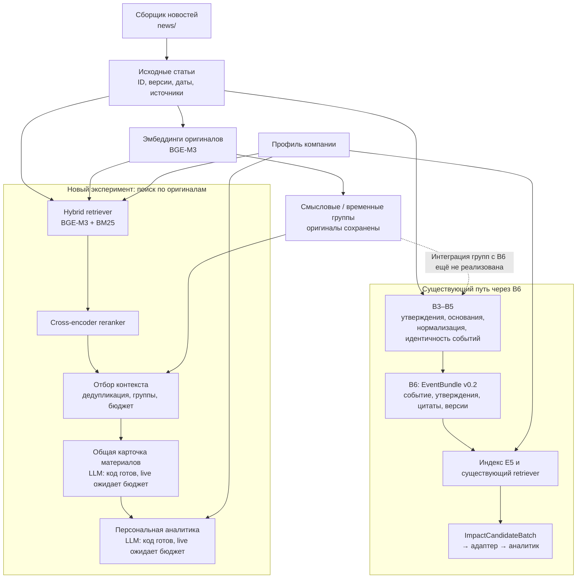

# Поток новостей: состояние ветки news-pipeline-gpu-lazy-retrieval

Схема отражает реализованные модули и локальный эксперимент на 23 октября 2026.
Она не означает, что все блоки соединены в production-сервис или HTTP API.
Код сборщика уже есть в `news/`. Полные оригиналы и версии сохраняются.

Смысловая группа — набор материалов для совместного чтения, а не доказательство
одного события. Разные даты, числа, прогнозы и отрицания сохраняются. Обобщение
может описывать несколько событий. Одно событие может иметь несколько публикаций;
одна публикация может содержать несколько событий.

В новой ветке исходные публикации являются единицами поиска. Группы помогают
отбирать контекст после поиска и reranking. До поиска не требуется превращать
весь корпус в общие LLM-новости или B6. Локальный проход до подготовки аналитических
запросов выполнен; новых live-вызовов для company-news эксперимента не было.

Путь «группа → EventBundle v0.2 → существующий retriever» требует отдельной
интеграции: извлечь и проверить ссылки утверждений, нормализовать доступные даты и
числа, разделить разные события, сохранить конфликты и опубликовать версии B6.
Это содержательная обработка, а не простое переименование JSON-полей.
Существующий retriever индексирует B6 в E5; BGE-векторы группы не подаются в него
как совместимые E5-векторы.

Источники: `news/README.md`, `llm/events/README.md`,
`llm/event_pipeline/semantic/README.md`, `retriever/README.md`,
`llm/event_pipeline/company_news/README.md`,
`backend/app/analyst/batch_adapter.py`, `backend/app/analyst/raw_adapter.py`.
