# Полный цикл: worker, сохранённые результаты и HTTP кабинет

Интеграционная ветка: `integration/full-cycle-backend`. База `origin/main=04500c1`,
ретривер/merge `origin/retriever=04bde29`, аналитик/адаптер
`origin/feature/analyst-retrieval-adapter=6cf4bc1`.
Refs обновлены через `git fetch --all --prune` перед работой. Из соседних веток
перенесены необходимые пакеты и их тесты; изменения сборщика из main сохранены.
Чистый complete-link механизм группировки взят без изменений из
`news-pipeline-clean=114cb10:llm/event_pipeline/semantic/core.py`.
Текущий коммит интеграции: `git rev-parse HEAD` в этой ветке.

```mermaid
flowchart LR
  C[Collector news_corpus.jsonl] --> A[Immutable ArticleRevision archive]
  A --> E[Pinned BGE-M3 / exact-text cache / validated native bundle]
  E --> G[Existing complete-link reading groups]
  G --> I[Staged SQLite index]
  I --> P[Atomic committed index pointer]
  P --> R[RetrieverService for company and role]
  R --> M[Lazy merge only on encountered pending group]
  M --> V[All event vectors then atomic apply / split reranking]
  V --> B[RetrievalCandidateBatch + trace]
  B --> L[AnalystService.analyze_batch + adapter diagnostics]
  L --> S[Private jobs and cards keyed by candidate / canonical event / context]
  S --> H[Existing HTTP feed and analysis endpoints]
  H --> U[HTTP cabinet]
```



## Воспроизведение без сети и платных моделей

Python 3.13+; команды из корня репозитория:

```sh
python -m venv .venv
.venv/bin/pip install -r backend/requirements-dev.txt
export PYTHONPATH=.:backend
.venv/bin/python -m app.full_cycle --data /tmp/my-full-cycle synthetic
FULL_CYCLE_MODE=persisted FULL_CYCLE_DATA=/tmp/my-full-cycle \
  DATABASE_URL=sqlite+aiosqlite:////tmp/my-full-cycle/api.db \
  .venv/bin/uvicorn backend.main:app --host 127.0.0.1 --port 8000
```

`synthetic` — явный приёмочный режим: четыре публикации → две группы → одно
объединённое событие и два разных события после split. Две компании, CEO/CFO,
неизвестная дата, исходные HTTPS URL и координаты цитат. Он использует настоящие
importer, SQLiteSearchStore, RetrieverService, MergeService, адаптер и аналитик,
с подменой только encoder и транспорта LLM. HTTP API ничего не генерирует.
Повтор команды на том же каталоге возвращает те же job/card IDs с нулём новых
вызовов и вычислений. Каталог с synthetic и реальными компаниями разделяйте явно.

Готовый HTTP экран через Docker, без локального Node:

```sh
docker compose -p full-cycle-proof build backend frontend news-collector
docker compose -p full-cycle-proof run --rm backend \
  python -m app.full_cycle --data /data/full-cycle synthetic
FRONTEND_PORT=18080 BACKEND_PORT=18000 \
  docker compose -p full-cycle-proof up -d backend frontend
```

Экран: **http://localhost:18080**. Войдите в существующий демонстрационный кабинет,
выберите `SYNTHETIC_FACTORY` / `SYNTHETIC_LOGISTICS` и CEO/CFO. Данные ленты и карточек
приходят из API и общего тома; `/config.js` содержит `apiMode: "http"`.
Синтетичность самих приёмочных материалов обозначена в карточках.

```sh
curl -s http://localhost:18080/api/v1/companies
curl -s 'http://localhost:18080/api/v1/companies/SYNTHETIC_FACTORY/news-feed?role=cfo'
curl -s 'http://localhost:18080/api/v1/companies/SYNTHETIC_FACTORY/processing-state?role=cfo'
# CARD_ID — event.event_id из ответа ленты, не upstream item_id.
curl -s "http://localhost:18080/api/v1/news/$CARD_ID/analysis?company_id=SYNTHETIC_FACTORY&role=cfo"
curl -s http://localhost:18080/api/v1/readiness

docker compose -p full-cycle-proof restart backend frontend
docker compose -p full-cycle-proof run --rm backend \
  python -m app.full_cycle --data /data/full-cycle synthetic
# Повтор curl должен вернуть те же ID и содержимое; worker показывает reused=true.
```

Обычный `docker compose up --build` тоже по умолчанию включает persisted API и HTTP
frontend. Без загруженных компаний и индекса API показывает отсутствие готовности,
а не подставляет seed. Старый демопуть включается явно:
`FULL_CYCLE_MODE=demo APP_API_MODE=mock`. Локальные legacy E2E используют demo по
умолчанию для обратной совместимости. `MOCK_MODE` не переключает новый worker.

## Реальный worker

Worker читает атомарно опубликованный файл существующего сборщика:

```sh
PYTHONPATH=.:backend python -m app.full_cycle --data /private/full-cycle worker \
  --corpus /private/news/news_corpus.jsonl \
  --profiles /private/company-store --company COMPANY_ID --role cfo --role ceo \
  --as-of 2026-10-24T00:00:00+03:00 --k 20 \
  --fingerprint VERIFIED_BGE_FINGERPRINT --dimension 1024 \
  --model-path /private/bge-m3 \
  --encoder-reference /private/bge-reference --every 60
```

Без `--every` выполняется один проход. `as_of` фиксирован и является частью
контекста: для следующего бизнес-периода передайте новый момент явно. Новые/исправленные
публикации создают новую редакцию; изменённое содержимое с тем же явным revision ID
отклоняется до кодирования. Пустой/неполный корпус и несогласованные bundles не
меняют указатель на пригодный индекс. Полный новый снимок исключает старые редакции
из текущего поиска; архив всех оригиналов и старые индексы остаются на диске.

Можно переиспользовать **native bundle**, задав `--vectors /private/native-bundle`
и `--clusters /private/clusters.json`, без загрузки модели. Fingerprint, размерность,
полный corpus hash, исходные text hashes, файлы NPY/mapping, нормализация и версии
проверяются штатным importer. Совпадения размерности недостаточно. Bundles с
фрагментными векторами требуют готовые ClusterSnapshot; default grouping использует
полные векторы. Большие корпуса >512 статей требуют scipy. Текущая граница группировки:
5000 единиц и 512 MiB оценки матрицы; превышение — явный отказ с сохранением индекса.
На проверенном корпусе 3012 статей пересчёт занял 6,60 s, пик процесса 476 MiB.

CPUEncoder использует только локальные веса BGE-M3 revision
`5617a9f61b028005a4858fdac845db406aefb181`, проверяет SHA-256 файлов, профиль
FP32/CLS/L2 и численную parity с документами и запросами reference. Сетевой загрузки
модели и усечения текста нет. Модель загружается лениво, только когда нужны новые
векторы; неизменённый корпус после рестарта не повторяет parity encoding.
Установка CPU runtime:

```sh
pip install torch==2.14.1 --index-url https://download.pytorch.org/whl/cpu
pip install -r retriever/requirements-cpu.txt
```

Дополнительный CPU image: `docker build -f backend/Dockerfile.encoder -t alfa-news-worker:local .`
после сборки backend. Для общего запуска задайте переменные из
`.env.example` и используйте
`docker compose -f docker-compose.yml -f docker-compose.full-cycle.yml up -d`.
Worker и API используют один UID/том `backend-data`; корпус collector доступен worker
через `news-data:ro`, веса/reference — отдельными read-only mounts. Каталог модели
должен содержать доступные обычные файлы: Hugging Face snapshot с симлинками на
непримонтированный `blobs` сначала скопируйте с разыменованием ссылок.

## Доверенные компании

Локальный `companies/manifest.json` формата `full-cycle-companies.v1` содержит:

```json
{
  "schema_version": "full-cycle-companies.v1",
  "companies": [{
    "company_id": "COMPANY_ID",
    "profile": "company-profile.json",
    "profile_sha256": "SHA256_OF_CANONICAL_PROFILE_JSON",
    "interests": "company-interests.json",
    "interests_sha256": "SHA256_OF_CANONICAL_INTEREST_JSON",
    "display": {
      "company_id": "COMPANY_ID", "name": "Название из доверенного профиля",
      "profile_version": "VERSION", "is_synthetic": false,
      "industry": "Отрасль", "region": "Неизвестно", "age_label": "Неизвестно",
      "revenue_bn_rub": null, "products": {}, "fts": {}
    }
  }]
}
```

Хэш вычисляйте `retriever.models.digest(json.loads(file.read_text()))`.
Нормализованный профиль и CompanyInterestSet соответствуют контрактам адаптера и
ретривера. Полные версии с реальными active flags/векторами неизменяемы после первого
использования; смените версию при изменении набора. Все пути внутри company store.
Manifest — доверенный локальный ввод оператора, не endpoint для загрузки пользователем.
Это прототип с прежним демонстрационным входом; многопользовательская аутентификация
и проверка владения компанией пока не добавлены.

Поисковые гипотезы не попадают в observed features. Graph выключен; явный
`--include-graph` требует активных graph interests. RAG банка не подставляется:
пустой bank context честно означает отсутствие переданной позиции банка.

## Подготовка существующего приватного эксперимента

`prepare_reference` — **явный** конвертер известного формата `run-20261023`.
Он проверяет ARTIFACTS.sha256, матрицы, профиль и все артефакты interest manifest,
сохраняет полные тексты, даты и provenance; создаёт native bundle, ClusterSnapshot
и manifest нескольких компаний. Это не автоматическое распознавание старых векторов.

```sh
export PYTHONPATH=.:backend
python -m app.full_cycle.prepare_reference \
  --news /private/run-20261023 \
  --topics /private/activity-interests-v1/embeddings-bge-m3 \
  --output /private/prepared --company U_100013 --company U_100090
python -m app.full_cycle --data /private/full-cycle worker \
  --corpus /private/prepared/articles.jsonl --vectors /private/prepared/native \
  --clusters /private/prepared/clusters.json --profiles /private/prepared/companies \
  --company U_100013 --role cfo --as-of 2026-10-24T00:00:00+03:00 --k 3 \
  --corpus-id CORPUS_ID_FROM_PREPARATION_REPORT \
  --fingerprint FINGERPRINT_FROM_PREPARATION_REPORT --raw-fallback
```

`--raw-fallback` в этом примере выбран явно для офлайн-прогона при недоступном merge.
Все такие публикации получают предупреждение о повторах. Без этого флага pending
группы удерживаются в deferred. 118 неполных групп старого экспорта остаются ambiguous.
Все исходные URL этого экспорта отсутствуют: сохранён null, URL не восстанавливаются
по именам каналов. Для новых данных URL штатного collector сохраняется до карточки.

## Live, состояния и повторные запуски

Без `--live` worker не создаёт сетевой LLM gateway, даже при наличии ключа.
Пропуск анализа сохраняется как `analysis_failed`, без бизнес-решения exclude.
Live требует `LLM_API_KEY`, явные `--shared-quota-db PATH --shared-call-limit N`
и `--budget-rub RUB`. Один постоянный SQLiteQuota ограничивает **сумму** вызовов
merge и аналитика, включая неудачные/неизвестные отправки. Ретраи, repair и запасная
модель в интеграционном runtime выключены. Рублёвый BudgetLedger относится к аналитику;
общая квота в вызовах также ограничивает merge (денежная тарификация merge в upstream
контракте отсутствует). `--merge-calls N` ограничивает новые merge-вызовы одного поиска.
Для live merge нужен совпадающий event encoder; никакой частичный результат не применяется.

Кэш/идемпотентность связывают company/profile/interest snapshots, corpus identity,
роль, as_of, параметры поиска/merge, model/prompt/policy. Готовое задание читается с
диска, новых вызовов нет. Ошибки не повторяются сами: `--retry-failed` — явное действие
оператора после сверки исхода прежних отправок. После аварии running job требует
такой сверки. Резервы общей квоты не снимаются автоматически.

Журнал различает include/watch/exclude, insufficient_evidence, analysis_failed,
budget_exhausted, context_too_large, deferred и unresolved. Старый AnalystOutput
сохраняет reason_code=analysis_failed; добавлен failure_code для исходного кода
ошибки. Маппер никогда не превращает транспортный отказ в «неинтересно».

API `/processing-state` сообщает not_started/running/ready/partial/failed/stale,
счётчики, ошибки и неполноту последнего обновления индекса. Изменение профиля/интересов
или корпуса помечает старую ленту stale. Исторические карточки по immutable ID доступны.
`/readiness` отдельно показывает готовность индекса, ingestion и worker heartbeat;
обычный `/` — liveness. HTTP чтение не вызывает encoder/LLM.

Collector публикует `collection-result.json`: collected, no_new или
all_sources_failed. Scheduler требует свежий структурный результат, ненулевой exit
при отказе; stale feed cache не доказывает здоровье источника. Healthcheck проверяет
последний успешный результат и возраст относительно NEWS_EVERY/таймаута. Docker CMD
не перекрывает NEWS_EVERY фиксированным `--every 3600`.

## Хранилище и идентичность

Все пути ниже — внутри `FULL_CYCLE_DATA` (по умолчанию `/data/full-cycle`):

- `pipeline.sqlite3`: revisions, неизменяемые profile/interest versions, jobs,
  cards, job_cards, состояние ingestion/worker и атомарный указатель на индекс.
- `indexes/<input-identity>/index.sqlite3`: originals, группы, текущие поисковые
  представления, vectors, merge applications/receipts. Старые поколения сохраняются.
- `embedding-cache.sqlite3`: exact embedding text hash + fingerprint + dimension.
- `merge.sqlite3`: приватный журнал запросов/ответов merge; общий quota DB задаётся явно.
- `analyst-cache/`, `analyst-responses/`, `analyst-budget.json`: приватные ответы,
  диагностика, фактические usage, резервирование бюджета.

Batch, retrieval trace, AnalystOutput, diagnostics, outcomes, snapshots и расходы
хранятся в job JSON внутри SQLite. Gateway usage before/after сохраняется отдельно,
включая затраты на ответы, не прошедшие JSON/QA. В Git/Docker context не попадают
ключи, приватные профили/новости, рабочие БД, векторы и runtime ответы.

Card identity: company + role + canonical_event_id + применимый context hash.
Reading group и общие источники не определяют дубликат. Источники/quotes связываются
по ID, не zip по позициям. Сохранены candidate_id, canonical_event_id, reading_group_ids,
revision_ids, полная строковая text_version, text SHA-256, URL/null, precision и точные
Unicode координаты [start,end). Merge текст помечен derived_merge и не выдается за цитату.

**Граница:** upstream event ID зависит от merge operation/draft. Стабильность между
перегруппировками не гарантирована; разные версии/разбиения не склеиваются молча.
Raw canonical ID устанавливает идентичность статьи, не межстатейного события.
Полнота/истинность merge и смысл цитат не доказаны одной ссылочной валидацией.

## Проверки

```sh
PYTHONPATH=.:backend python -m pytest retriever/tests llm/cluster_merge/tests backend/tests/test_full_cycle.py -q
PYTHONPATH=.:backend python -m unittest discover -s backend/tests/analyst -t backend -q
python -m unittest discover -s ranking/tests -q
PYTHONPATH=.:backend ANALYST_MODE=template python backend/test_e2e.py
PYTHONPATH=.:backend ANALYST_MODE=cached python backend/test_e2e.py
cd frontend && npm ci && npm run build
# Из корня:
docker compose config --quiet
docker compose build backend frontend news-collector
```

Фактические результаты и границы проверки — в
[отчёте приёмки](reports/full-cycle-backend-20261024.md).
