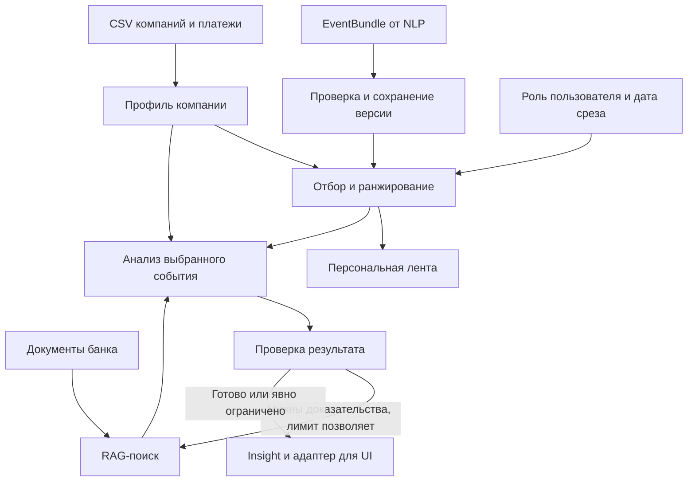

> Исторический план. Часть об отборе и балльном ранжировании заменена [планом Impact Retriever](retriever/implementation-plan.md). Старый ранкер удалён; выполненные инфраструктурные задачи остаются применимыми.

# План персонализации и аналитики новостей

Рабочая ветка: `news-personalization`. Дата: 21 октября 2026 года.

Основание: [разбор текущей ветки](news-personalization-review.md), [EventBundle v0.1](b6-event-contract.md), [контракт UI](frontend-api-contract.md). Ниже — план работ, а не перечень уже реализованных функций.

**Подробные задания для передачи агентам:** [пакет заданий 01–07](agent-tasks/README.md). В нём есть общий контракт интерфейсов, отдельный исполнимый план каждого этапа, команды запуска, негативные тесты и матрица приёмки. Начинать с задания 01; остальные используют его результаты.

Пакет 01–03 уточнён после [проверки внешнего LLM-отзыва](agent-tasks/review-01-03.md): подэтапы A/B, единый ingestion clock, качество графовых долей и конкретные mapping rules. Для точных полей и порогов использовать актуальные INTERFACES.md и задания; этот документ описывает общую последовательность.

**Статус реализации:** блоки 01–03 выполнены тремя параллельными агентами, пройдены 53 теста и offline CLI-демо. [Итоговый отчёт](implementation/00-orchestration.md) отделяет реализованное от оставшихся 04–07 и независимой оценки качества.

**Обновление следующего этапа:** реализованы RAG 04 и offline/fixture workflow 05 с QA/историей/диалогом. Пройдены 125 тестов суммарно и запуск на реальном локальном корпусе. [Отчёт 04–05](implementation/04-05-orchestration.md) фиксирует ограничение: живой LLM и независимого semantic review пока нет, fixture-карточка имеет status=limited. Следующая работа — 06–07.

## Результат блока

Для выбранной компании и роли пользователя возвращать:

1. Ленту событий, отсортированную по значимости, с объяснением порядка.
2. Карточку выбранного события: что произошло, почему важно компании, риски, возможности, следующий шаг, подтверждённая позиция банка и источники.
3. Явные ограничения: чего мы не знаем, где источники расходятся и что нужно уточнить.
4. Сохранённую трассу: версия новости, профиль и признаки, правила ранжирования, найденные документы, выводы, проверки и стоимость.

Событие общее для всех компаний; оценка и интерпретация персональные. Роль влияет на приоритет и управленческие действия, но не меняет факты новости.

## Границы ответственности

Наш модуль принимает EventBundle и не повторяет парсинг источников, группировку статей и первичное извлечение фактов. Внутри сохраняются модальность, отрицания, конфликты и ссылки исходного объекта.

В нашей зоне: профиль, сопоставление новости с компанией, ранжирование, RAG-запрос, интерпретация, самопроверка, контекст запуска и выходной JSON. Backend подключает функции к API, хранению и авторизации; frontend отображает ответ. Бюджетный шлюз должен быть общим для NLP и аналитики, поскольку ключ и лимит командные.

## Что используем из имеющегося

| Уже есть | Действие |
|---|---|
| Схема B6 и 4 примера | Сделать их первым входом и контрактными тестами |
| Ранкер в `ml/ranking-baseline` | Выборочно перенести профили, граф, правила, метрики и полезные тесты; адаптировать к B6 |
| CSV компаний и платежей | Строить профили и наблюдаемую сеть; сырые данные оставлять локально |
| RAG: подготовка PDF и BM25 | Подключить к сценарию и проверить поиск на вопросах нашей аналитики |
| Черновая схема Insight | Согласовать версии и статусы, реализовать генерацию и проверку |
| UI-контракт и примеры | Сделать отдельное преобразование результата; не подменять вход B6 форматом фронта |

Не переносить прежнюю ML-ветку целиком: её код и прежняя документация имеют другую основу. В этой ветке `data/processed/ranking/` пока видна как untracked; до добавления файлов вернуть правило игнорирования производных профилей и результатов.

## Этап 1. Контракты и приём событий

**Задача:** создать стабильную границу между NLP, профилями, ранкером и аналитиком.

- Зафиксировать `CompanyProfile`: ID/версия, отрасль и ОКВЭД, география, продукты, ВЭД, интервальные признаки, связи, неизвестные поля, происхождение данных.
- Каждый используемый признак получает `feature_id`, значение, статус качества и источник. Версия профиля зависит от данных и версии нормализации.
- Зафиксировать `Relevance`: event ID/version, company ID/profile version, роль, `as_of`, score 0..1, уровень, причины, вклады, feature IDs, claim IDs, ограничения, версия правил. Score — относительный приоритет, не вероятность и не сумма ущерба.
- Уточнить выход Insight: версии события/профиля, статусы частичного результата, неизвестная дата, различие факта, прогноза, позиции банка и вывода AI.
- Реализовать загрузку JSON/JSONL. Сначала читать fixtures; позже заменить источник вызовом producer.
- Проверять JSON Schema и межполевые инварианты: ссылки, уникальность ID, периоды, диапазоны, цитатные координаты, пути конфликтов, согласованность метаданных.
- Сохранять неизменяемый снимок, хэш и время получения. Повтор того же ID/version/payload идемпотентен; иное содержание при той же версии — явная ошибка.
- `withdrawn` инвалидирует текущие персональные результаты. `insufficient` и пустые claims не проходят в обычный анализ; `partial` сохраняет ограничения.

**Результат:** схемы профиля/релевантности, загрузчик B6 и локальное хранилище снимков.

**Приёмка:** четыре исходных примера читаются; повреждённые ссылки и диапазоны отклоняются; неизвестные расширяемые метки сохраняются; повтор, обновление и отзыв обработаны предсказуемо.

## Этап 2. Профиль компании

**Задача:** превратить строку банковского CSV в проверяемый бизнес-контекст.

- Перенести и проверить нормализацию из прежнего ранкера: ОКВЭД, отрасль, регион, город, возраст, численность, продукты, ВЭД, GROUP_ID.
- Различать `true`, `false`, `unknown`; интервалы возраста/численности не превращать в выдуманное точное число.
- Выручку сохранять с raw-значением и статусом единиц; конвертацию в рубли/миллиарды включать только при подтверждённых единицах или явно помеченном допущении.
- Конфликтующий ID `U_428697` не разрешать произвольным выбором строки. Возвращать конфликт профиля.
- Выбирать компанию из доступной базы по ID. Новая строка/новый профиль не должны требовать изменения кода или переобучения.
- Подготовить 3 демонстрационных профиля с разными каналами влияния. Для детерминированных тестов использовать отдельно помеченные синтетические профили.
- Для выбранных компаний построить агрегаты входящих/исходящих платежей: контрагент, направление, доля наблюдаемого потока, покрытие профилями и ограничения выборки.
- Не называть долю платежей долей выручки; не приписывать платежам отсутствующие период, валюту или назначение.

**Результат:** `get_company_profile(company_id)` и профиль с provenance, пригодный для ранкера и LLM.

**Приёмка:** три разных профиля воспроизводимы; происхождение каждого признака доступно; неизвестности не маскируются нулями; обновление данных меняет версию.

## Этап 3. Отбор и ранжирование

**Задача:** быстро найти потенциально важные события и объяснить порядок ленты до вызова дорогой модели.

- Создать версионируемые словари соответствий: метки B6 ↔ ОКВЭД/отрасли, продукты, страны/регионы, экономические каналы.
- Отбирать кандидатов по нескольким независимым каналам: отрасль, продукты, география/ВЭД, макроэкономика, подтверждённые связи. Не ограничиваться совпадением названия отрасли.
- Для неизвестных меток предусмотреть ограниченный текстовый fallback и диагностический статус; не объявлять событие нерелевантным только из-за незнакомой метки.
- Перенести объяснимый скоринг: сила связи с компанией, существенность подтверждённого изменения, срочность/стадия, свежесть, приоритет для роли. Веса сначала задаются правилами и затем корректируются по разметке.
- Сохранять причины: какие claims, признаки и правила дали вклад. При клиппинге/нормализации согласовать реальные итоговые вклады с тем, что показывает UI.
- Хранить значимость отдельно от достаточности доказательств. Важный, но противоречивый сигнал может требовать проверки; спорное число не становится фактом.
- Убирать повторы версий из активной ленты, ограничивать засилье одной темы; поддержать пересчёт при новом событии/профиле и фиксированный `as_of`.
- Контрагентский канал включать только с подтверждённым mapping news entity → банковский ID. До его появления — явно синтетический тест либо отключённый канал с объяснением ограничения.

**Результат:** `rank_events(bundles, profile, role, as_of)` → отсортированная лента и объяснения.

**Приёмка:** один набор событий даёт осмысленно разный порядок для трёх компаний; в ответе нет неподтверждённых связей; отзыв убирает устаревшую карточку; все причины разрешаются в признаки/claims.

Пример теста: рост стоимости топлива должен быть важнее для перевозчика, чем для компании без известной транспортной экспозиции. Но новость о ставке может быть важна обеим компаниям через разные продукты. Конкретные оценки определяются правилами и разметкой, а не зашиваются под ID демо-компаний.

## Этап 4. Поиск аналитики банка

**Задача:** подбирать доказательства для конкретного механизма влияния.

- Проверить доступность локального корпуса и способ его воспроизводимой подготовки из PDF.
- Составлять запрос по показателю, объекту, модальности, периоду и бизнес-контексту. Ввести mapping тем: например, B6 `rates` → RAG `policy_rate`.
- Использовать существующий BM25 как baseline. Сохранять document ID/hash, chunk ID, страницу, дату, цитату, поисковый запрос и применённые фильтры.
- Проверять временную пригодность и горизонт: прогноз на конец года не заменяет наблюдаемое значение сегодня. Исторические и недатированные материалы обрабатывать явно.
- При пустой/неподходящей выдаче сделать ограниченный повторный поиск с уточнением или расширением запроса.
- Если достаточных доказательств нет, вернуть `no_bank_evidence`; позицию банка не генерировать из общего знания LLM.

**Результат:** `retrieve_evidence(bundle, profile, relevance, as_of)` → EvidenceBundle.

**Приёмка:** на небольшом вручную проверенном наборе вопросов находятся нужные страницы; для пустого корпуса и неподходящих дат предусмотрен честный ограниченный ответ.

## Этап 5. LLM-аналитик и собственная агентная логика

**Задача:** из события, профиля и evidence получить объяснение для компании.

- Один собственный Python-оркестратор со стадиями и состоянием: подготовить контекст → получить evidence → интерпретировать → проверить → при необходимости повторить поиск/исправить → выдать результат.
- Контекст запуска включает исходный bundle, версии, профиль, relevance, evidence, конфликты, ограничения и предыдущие результаты инструментов.
- Генератор получает компактный контекст и структурированный формат ответа. Внешние тексты трактуются как данные, а не как инструкции к вызову инструментов.
- Формировать блоки «что произошло», «почему важно», «риски», «возможности», «следующий шаг». Позиция банка появляется только при прямой поддержке банковским источником.
- Каждое персональное заключение ссылается на источник и признаки клиента; расчёты отдельно отмечаются как производные и содержат исходные величины/допущения.
- При отсутствии типа ставки/суммы долга давать условный канал воздействия и конкретное уточнение, без расчёта выдуманного финансового эффекта.
- Роль пользователя меняет порядок действий и акценты. Базовое продолжение диалога использует сохранённый run/context и при необходимости ограниченный новый поиск.
- Начать с одной доступной разрешённой модели аналитика. Кандидат из текущей политики — GLM-5.3-Flash; фактический model ID, доступность и цену подтвердить у провайдера. Дополнительные модели добавлять только после измеримой необходимости.

**Результат:** `analyze_event(bundle, profile, relevance, role, as_of)` → Insight с trace.

**Приёмка:** четыре сценария B6 пройдены; прогноз остаётся прогнозом; конфликт не разрешается голосованием; разные компании получают разные доказуемые механизмы влияния. При отсутствии LLM-доступа остаётся работоспособна проверка/лента, а генерация возвращает явный статус недоступности.

## Этап 6. QA, бюджет, кэш и интеграция

Эти механизмы проектируются с первого этапа и обязательно включаются до живых LLM-вызовов.

- Проверки кода: схема, все ссылки, версии, числовые единицы/диапазоны, допустимость источников, наличие признаков у персональных выводов.
- Проверка смысла: утверждение поддержано источником, модальность/отрицание сохранены, позиция банка не выдумана, вывод не зависит от неразрешённого конфликта. Не заявлять, что одна JSON Schema доказывает отсутствие галлюцинаций.
- Ограничить циклы: начальная политика — до двух повторных поисков и одного исправления генерации, всегда в пределах общего бюджета. После исчерпания попыток — ограниченный результат.
- До вызова резервировать стоимость и токены с учётом максимального ответа, после вызова сверять фактическое usage. Резервирование атомарное, общее с остальными модулями; учитывать retries и перезапуск.
- Получить командную квоту, тарифы и численный дневной токен-лимит. Известные 500 ₽/день относятся ко всей команде; этот модуль не может расходовать их независимо от NLP.
- Кэшировать по версиям события/профиля, роли, `as_of`, корпусу RAG и конфигурации. Сохранять статус cached/live; новая версия и отзыв требуют инвалидирования.
- LLM-анализ выполнять по запросу карточки либо для ограниченного top-K. Не генерировать заранее каждую пару всех компаний и всех новостей.
- Сделать отдельный адаптер Insight → frontend types: статусы, evidence, дата, синтетичность, признаки и score. Проверить отображение неизвестного, а не только happy path.
- Согласовать с backend вызовы для ленты, карточки, уточняющего вопроса и feedback. Доступ к компании проверяет backend; кэш ответа не должен обходить эту проверку.

**Результат:** воспроизводимый модуль, подключаемый к backend, с контролируемой стоимостью и ограниченными повторами.

**Приёмка:** повтор запроса использует допустимый кэш; новый профиль пересчитывает ответ; бюджет заканчивается предсказуемо; ни одно неуспешное QA не выдаётся как полностью проверенный результат.

## Этап 7. Оценка качества и демонстрация

Разметку для оценки начать параллельно с профилями, не откладывать до конца разработки.

- Подготовить минимум 20 разных событий × 3 профиля = 60 оцениваемых пар. Четыре B6-примера — только контрактные кейсы; дополнить отраслью, санкциями/ВЭД, контрагентом, нерелевантным шумом, отрицанием, обновлением и отзывом.
- Попросить аналитика независимо оценить значимость по шкале 0–3 и указать причины. Отдельно оценивать недостаточность данных. Отделить набор настройки от контрольного; версии/дубли одного события держать в одном наборе.
- Для отбора: recall важных событий до ранжирования. Для порядка: nDCG@5, Precision@5 и пропущенные события с максимальной значимостью. Не считать неразмеченные пары автоматически отрицательными.
- Для объяснения: структурное покрытие ссылками и отдельная ручная проверка смысловой поддержки; ошибки фактов/чисел, выдуманная позиция банка, корректность ограничений, полезность следующего шага.
- Для RAG: попадание нужного документа/страницы в top-K и временная пригодность. Для системы: p50/p95 времени, стоимость и токены на инсайт, доля попаданий в кэш.
- Зафиксировать baseline до настройки. Численные цели ранжирования поставить после первой независимой оценки; не выдавать результат на самостоятельно придуманных метках за доказанное качество.
- Демо: выбрать компанию → показать ленту → открыть событие → показать источники/признаки → сменить компанию → увидеть другое обоснование → задать уточнение → загрузить новую версию и увидеть пересчёт.

**Приёмка:** все договорённые защитные кейсы проходят; структурные ссылки разрешаются полностью; нет критических ошибок в проверенном демо-наборе; качество и ограничения описаны с размером выборки. Это не гарантия отсутствия ошибок на любых будущих новостях.

## Порядок реализации и контрольные точки

| Очерёдность | Проверяемый результат | Зависимости |
|---|---|---|
| M1: контракты + загрузчик + 3 профиля | Событие и профиль валидны, версии/происхождение сохранены | Fixtures и локальные CSV уже есть |
| M2: отбор + ранкер | Три разные объяснимые ленты без LLM | M1; разметку начинать параллельно |
| M3: RAG + аналитик + QA/бюджет | Полная карточка выбранного события | M1/M2, корпус; для живой генерации — API/тарифы/лимиты |
| M4: UI-адаптер + уточнение + проверка | Сквозное интерактивное демо и отчёт о качестве | M3 и backend-интеграция |

RAG можно улучшать параллельно профилям/ранкеру. На двух исполнителей: первый ведёт CompanyProfile, отбор и ранжирование; второй — RAG, интерпретацию и QA. Если второй уже занят producer NLP, в нашей ветке сначала закрываем M1/M2 и только затем подключаем аналитика. Backend получает схемы и примеры на M1, не в конце.

## Предлагаемое размещение кода

Сохранить существующие зоны `ranking/`, `llm/`, `data/`, не создавать новую систему папок.

| Зона | Планируемые компоненты |
|---|---|
| `docs/contracts/` | Схемы CompanyProfile/Relevance и согласованные версии контрактов |
| `ranking/` | B6-адаптер/валидация, профили, граф, candidate retrieval, скоринг, составление ленты, метрики |
| `ranking/config/` | Нормализация отраслей/географии, каналы влияния и веса правил |
| `llm/rag/` | Построение запросов, поиск и упаковка EvidenceBundle |
| `llm/agent/` | Контекст запуска, оркестратор, клиент модели, QA, бюджет, кэш и адаптер Insight |
| `data/examples/` | Только явно синтетические fixtures и разметка, разрешённая к публикации |
| `data/processed/` | Локальные индексы, профили, снимки и trace; чувствительные производные исключать из Git |

Все использованные библиотеки/модели/источники фиксировать в THIRD_PARTY_NOTICES; зависимости запуска закреплять версиями. Секреты передавать через окружение, примеры конфигурации — без ключей. С backend согласовать единый способ запуска и Docker; наш модуль должен запускаться и проверяться отдельно через CLI до подключения API.

## Что отложить до работающего MVP

- Дообучение модели: пока нет достаточной разметки и измеренной причины его делать.
- Эмбеддинги, гибридный поиск и LLM-reranking: добавлять по результатам ошибок baseline, с проверкой разрешённости модели и стоимости.
- Отдельную модель на каждую стадию и сложную мультиагентную систему.
- Автоматическое узнавание обезличенных компаний по реальным названиям без справочника.
- Расчёт денежного ущерба без экспозиции, условий договоров и подтверждённых единиц.
- Автоматическое переобучение по feedback; сначала собирать отзывы и разбирать их с аналитиком.

Первый рабочий инкремент: прочитать четыре EventBundle, получить три профиля и сформировать объяснимую ленту для каждого. После этого подключать RAG и генерацию к уже проверяемой персонализации.
