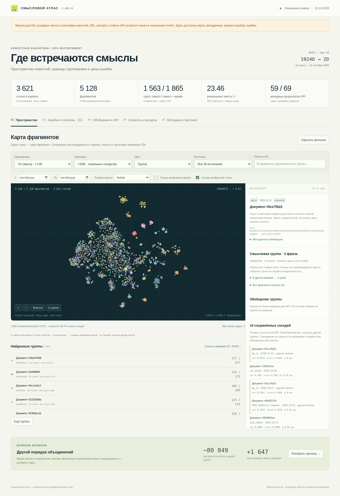

# GPU-эксперимент и интерактивный атлас

[Отчёт](REPORT.md) · [Интерактивная визуализация](index.html) ·
[Сравнение с news-pipeline-clean](../../implementation/news-pipeline-clean-overlap-review.md)

Скачайте ветку или клонируйте репозиторий и откройте `index.html` в Chrome.
GitHub показывает HTML как исходный код; сервер и сеть самому атласу не нужны.

```bash
git fetch origin
git switch news-pipeline-gpu-report
# Откройте docs/reports/semantic-gpu-20261023/index.html в браузере.
```



Все 5128 точек, оба варианта группировки, исходные scores соседей (6 знаков),
21 разбор ошибок/ограничений, метрики GPU/CPU/API и диагностические переходы
сохранены. Заголовки и тексты новостей, URL, prompts и финальные ответы API,
ключи и рабочие базы в эту версию **не включены**. Полный отчёт с исходниками
остаётся локально в игнорируемом `data/processed/event_pipeline/`.

- `projection.json`: ID, координаты двух проекций и измерения искажения;
- `issues.json`: наблюдения, гипотезы, предложения и способы проверки;
- `manifest.json`: хэши отчёта, HTML и данных;
- `browser-check.json`: сценарии и результат проверки интерфейса;
- `privacy-check.json`: сохранность геометрии/членства и проверка границы публикации.

Качество не объявляется production-готовым. Ручные оценки — черновик Codex
без независимого человеческого арбитража. Валидные IDs не доказывают
поддержку утверждения; положение на 2D-карте не заменяет исходный cosine.

Воспроизведение из уже готового локального отчёта, без новых API/GPU-вызовов:

```bash
.venv_events/bin/python scripts/semantic_gpu/publish_report.py
.venv_events/bin/python scripts/semantic_gpu/verify_public_report.py
.venv_events/bin/python scripts/semantic_gpu/check_report.py \
  --report docs/reports/semantic-gpu-20261023/index.html
```

Первые два скрипта используют только стандартную библиотеку Python.
Проверка браузера требует `playwright==1.64.1` и установленный Chrome.
