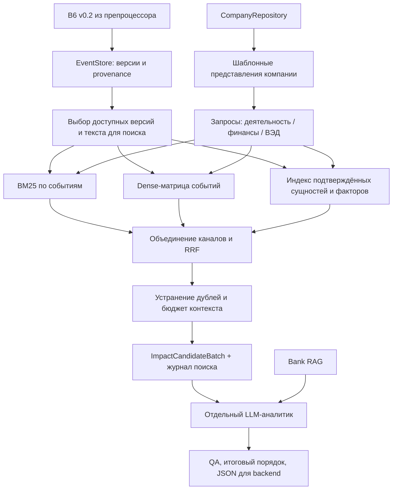

# Архитектура Impact Retriever

Статус: проект следующей реализации. Старый балльный ранкер удалён; описанные ниже модули поиска ещё не написаны. Это основной план, заменяющий прежнюю часть планов о candidate scoring и feed selection.

## Цель и границы

Для `(company_id, role, as_of)` найти потенциально полезные события из доступного к этому моменту новостного окна, сохранить основания отбора и передать ограниченный по токенам набор аналитику. Основная метрика — не потерять важные события до анализа. Cosine/RRF не являются вероятностью важности или размером ущерба.

Ретривер не пишет финансовые выводы, позицию банка и окончательную ленту. Аналитик может отклонить любого кандидата, запросить контекст или вернуть недостаточность данных. Валидация аналитики и адаптация итогового JSON остаются отдельными этапами.

## Выбранное направление поиска

MVP: компания → события. Индекс содержит события; 1–3 представления выбранной компании становятся запросами. Это соответствует сценарию UI «выбрать компанию → открыть ленту». Полный анализ всех пар 85 тысяч компаний × все новости не выполняется.

Входящий поток обновляет индекс один раз на новую версию события. Обратный режим «новость → все потенциально затронутые компании» нужен для будущих уведомлений; это отдельный индекс и отдельная оценка полноты. Не смешивать два направления в одном эксперименте.

## Схема



## Что переиспользуем

| Компонент | Решение |
|---|---|
| B6 validation и EventStore | Сохранить; строгие ID, версии, hashes, timestamps |
| CompanyRepository | Сохранить; исправить известную семантику полей и версии до построения индекса |
| Платёжный граф | Сохранить как наблюдаемые связи; не делать обязательным для отбора |
| Entity mapping | Только подтверждённый mapping; публичное имя не связывать с анонимным ID по догадке |
| CPU-эксперимент | Переиспользовать способ загрузки/кодирования после выделения общего encoder; проверить query/passage |
| Старый engine/signals | Удалены; не переносить group caps, min_feed_score, topic cap и обязательные event aliases |
| Старые Relevance/Insight | Только существующие артефакты/аналитические тесты; новый handoff требует адаптации |

Переименование `ranking/` с инфраструктурой не входит в первую итерацию: это создаст лишнюю миграцию импортов. Новая логика живёт в `retriever/`.

## Профиль компании

Шаблонные, детерминированные представления:

1. `business`: ОКВЭД, описание деятельности, подтверждённая отрасль; отдельно происхождение выведенной отрасли.
2. `finance`: известные положительные признаки кредита, лизинга, депозита и других продуктов; возможные экономические вопросы явно условны.
3. `trade_geo`: известное участие в ВЭД, страны, регион регистрации. Регион регистрации не объявлять географией операций.

Каждый раздел содержит text, feature_ids, quality, unknowns, representation_version и text_hash. Если информации нет — раздел отсутствует, а не превращается в общий текст «неизвестно». Факты и предположения хранятся отдельно. Наличие кредита не означает плавающую ставку; страна ФТС не доказывает валюту расчёта.

Первая версия не вызывает LLM для профиля. Опциональное обогащение позже — отдельный эксперимент на тех же размеченных парах. Платёжный раздел добавляется отдельно, с направлением, периодом, наблюдаемыми долями и покрытием. Он не устанавливает поставщика, покупателя или зависимость по себестоимости.

`GROUP_ID` сохраняется в контексте. Обогащение отраслевыми/продуктовыми признаками членов группы — отдельный условный канал с указанием конкретного участника; не приписывать его признаки выбранному юрлицу и не суммировать выручку как консолидированную без доказательств.

Известные исправления перед использованием профилей: REVENUE_COMPANY — годовая выручка 2025 в RUB, 1000 — техническое значение; NEGATIVEMARK — наличие информации о ключевом владельце; CLIENT/PROSPECT/CLOSE_CLIENT различать. Платежи агрегированы за заявленный период, дат отдельных операций нет. Проверять пригодность snapshot к as_of; не изображать платёжные данные точным состоянием на историческую дату. Источники разъяснений — `docs/company-data-and-news-research-context.md`.

## Представление события

Источник истины — исходный EventBundle, сохранённый с hash. Текст поиска: заголовок + исходные claims с модальностью/отрицанием/сценарием + известные участники и география. UUID, технический JSON и выдуманный экономический эффект в embedding не входят.

Пустые industries/factors и event_type=other не препятствуют BM25/dense. При partial событие допустимо при наличии исходных утверждений и доказательств; ограничения передаются аналитику. Невалидные bundles не индексируются; insufficient и withdrawn не попадают к аналитику.

Длинные тексты: один документ BM25 на событие, dense-фрагменты по границам claims, ограниченные токенизатором. Если один claim слишком длинный — перекрывающиеся текстовые окна с offsets. Ни одна часть не исчезает молча; ссылки и offsets сохраняются. Поиск агрегирует фрагменты по событию через максимум, без бонуса за число фрагментов. Число фрагментов/лимиты и стоимость учитываются отдельно.

Derived economic factors — дополнительное представление с basis и статусом inferred. Они не меняют source claims и не являются обязательным условием поиска. Пустое обогащение не должно обнулять кандидатов.

## Поисковые каналы и слияние

- BM25: русский tokenizer/нормализация с отдельной проверкой морфологии и аббревиатур. Словари версионированы. Нулевые совпадения не превращать в произвольную выдачу.
- Dense: один embedding backend для запросов и документов. Начальный кандидат — уже измеренный E5-small INT8 на CPU; качество сравнить с E5-large/BGE-M3 позже, не фиксировать 1024 как требование.
- Structured: явные совпадения подтверждённых сущностей, выбранных экспозиций и признаков. Канал расширяет union; отсутствие сигнала не исключает кандидата других каналов.

Для E5 в выбранном направлении company query кодируется с `query:`, событие — с `passage:`. Старый CPU-эксперимент использовал обратную постановку, поэтому его готовые матрицы не подмешиваются в новый индекс. Fingerprint включает model/revision, tokenizer, pooling, normalization, precision, prefixes и text/chunk policy. Кодирование CPU batch=1 — исходная настройка; другой batch проверяется на численную устойчивость.

Стартовые настройки для эксперимента: top-50 на канал/раздел, union до 250 различных событий; k_RRF=60. Для dense брать максимум `1/(60+rank)` по разделам компании, а не сумму всех разделов. Затем сложить вклад dense, BM25 и structured с начальными весами 1. Это предотвращает автоматическое утроение веса dense. Tie-break — event_id. Настройки гипотетические и меняются по dev-разметке.

Получаем упорядоченный пул до 100 событий. Без старого score threshold и ограничения «два other». Перед аналитиком — бюджет токенов и ориентир до 20 событий; ни 20, ни 100 не являются обязательной заполненностью. До разметки нет универсального порога cosine. Для нулевого/слабого сигнала фиксировать unknown, не заявлять доказанную релевантность. Разделять пустую базу, отсутствие совпадений, отказ канала и сокращение по бюджету.

Часть бюджета (стартовая гипотеза до 20%) резервировать для кандидатов, уникальных для отдельных каналов, чтобы fusion не стирал потенциально важные находки. Дубли отбирать только после union. Каждый отброшенный из-за бюджета кандидат остаётся в журнале с причиной. Эффект резерва измеряется, не объявляется улучшением заранее.

## Версии, время, индекс

EventStore выбирает последнюю доступную на as_of версию до проверки active. Нельзя восстановить старую active после withdrawn. Также проверяются producer update, receipt и публикации источников. Unknown publication — отдельная явная политика: поиск по receipt с limitation, без придуманной даты; сравнить такую политику с исключением на dev.

В MVP индекс строится для явно заданного as_of и окна. Manifest содержит список event snapshots с hashes, snapshot_id, cutoff, model/text policy, размеры и checksums файлов. Query требует совпадения as_of и manifest либо явной пересборки. Это проще и честнее скрытого использования будущей версии при историческом запросе.

Следующая стадия — инкрементальная публикация immutable index snapshots и атомарное переключение указателя. Изменённая/отозванная версия удаляется из активной выдачи. Во время запроса все каналы читают один snapshot. Если индекс отстал, вернуть index_stale и watermark, а не незаметно обслужить как актуальный.

Начальное хранение: существующий SQLite EventStore + локальные BM25-артефакты + float32 NumPy-матрица с точным поиском, model files отдельно. При доказанной проблеме latency добавить ANN и проверить потерю Recall относительно exact. Не нужны новый сервер БД и отдельный HTTP-микросервис для первого работающего пути.

## Дубли и события

Препроцессор уже создаёт EventBundle; не строить второй независимый event taxonomy. Сначала убрать повторные версии и точные дубли доказательств. Разные обновления одной истории сохраняются как связанные версии/события. Два bundles из статьи не считать автоматически одним событием: возможны независимые факты.

Event grouping между разными ID — отдельная версия правил и отдельный тест. Объединение никогда не удаляет sources, claims, conflicts. Контракт хранит список member snapshots. Начальный кандидат имеет один member; grouping можно добавить без смены смысла контракта.

## Объяснения и аналитик

Dense match объясняется победившим разделом, feature_ids и найденными фрагментами. Cosine не создаёт объяснение «компания использует Домодедово». Возможный механизм появляется только как явно обозначенная гипотеза с basis и unknowns.

Runtime возвращает полезные факты вместе с trace ID. В LLM не передаются сырые векторы и технические score; журнал хранит их для аудита. При этом аналитик получает полный нужный профиль, а не только признаки, совпавшие у ретривера.

Аналитик запрашивает Bank RAG, проверяет механизм и может abstain/reject. Оплата — только для активных компаний и ограниченных пачек. Предварительно резервируется токеновый/денежный бюджет; размер пачки определяется токенами и ценой провайдера, а не фиксированным числом «40B». Не предполагается, что батч сам по себе устраняет стоимость входных/выходных токенов.

Итоговое ранжирование по результатам аналитика, QA и UI-контракт — отдельная задача. Нельзя подставить retrieval_score в старый бизнес-score фронтенда.

## Предлагаемая структура (ещё не реализована)

```text
retriever/
  contracts.py                  # dataclasses/validation + semantic checks
  company_views.py              # шаблонные разделы и происхождение
  event_views.py                # B6 → поисковые документы, claims/offsets
  eligibility.py                # время/версии/quality/availability
  embeddings.py                 # CPU encoder + cache/fingerprint
  index.py                      # manifest, build/load, immutable snapshot
  channels/{lexical,dense,structured}.py
  fusion.py                     # RRF, dedup, diversity и бюджеты
  service.py                    # retrieve_candidates, построение handoff
  __main__.py                   # index / retrieve / evaluate
  evaluation/                   # разметка, метрики, сравнения
  tests/
```

Предлагаемый in-process API: `retrieve_candidates(profile, *, role, as_of, index, config) -> RetrievalResult`. Индекс/репозиторий создаются один раз на worker; запрос не перечитывает CSV и не сканирует все платежи. API возвращает `candidate_batch` и `trace`, а не `feed`.
