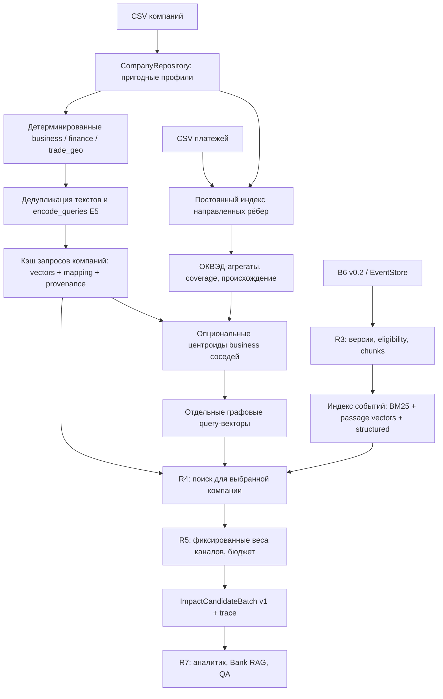

# План эмбеддингов компаний для Impact Retriever

Статус: **только проектирование**, 22.10.2026. Реализация, запуск агентов-исполнителей, массовый расчёт и платные API в рамках этого задания не выполняются. Все сигнатуры, команды и новые файлы ниже — будущие. Документ дополняет [архитектуру](../architecture.md), [R0–R8](../implementation-plan.md) и [ImpactCandidateBatch v1](../contract.md), не подменяет B6.

## A. Architecture Decision Record: CE-001

**Решение MVP:** до трёх независимых 384-мерных запросов `business`, `finance`, `trade_geo`. Представления без содержательных подтверждённых входов отсутствуют; количество — 0–3, а не обязательно три. В текущем пригодном датасете activity доступна; новые неполные профили могут иметь ноль views. Нет глобального universal-вектора в рабочей конфигурации.

**Эксперимент:** дополнительно до двух `graph_incoming` / `graph_outgoing`, по умолчанию выключены. Вектор — нормированная взвешенная сумма business-векторов пригодных соседей соответствующего направления. Три политики: equal, amount_share, sqrt_share. `sqrt_share` — стартовая инженерная гипотеза, не измеренный победитель. Граф обязателен только для этого эксперимента, базовый MVP может работать без его загрузки.

**Контрольные альтернативы:** universal, base3 + graph_combined, base3 + структурированные отраслевые агрегаты без графовых векторов, base3 + текстовые описания окружения. Не включать всё одновременно и не объявлять прирост до human-gold.

| Конфигурация | Информация / шум / объяснение | Покрытие | Построение и обновление | Совместимость с E5 и гипотеза Recall@20 |
|---|---|---|---|---|
| Universal | Один текст, проще эксплуатация; финансы/ВЭД могут теряться в общей теме; объяснение менее точное | Все с любым содержательным base view | Один вызов на уникальный объединённый текст; любой аспект инвалидирует весь текст | Обычный query; полезный контроль. Экономию нельзя заранее считать достаточной компенсацией потерь |
| Три тематических — MVP | Раздельные аспекты, явные feature refs; риск общих финансовых/региональных новостей | 0–3 по наличию данных; business доступен для пригодных записей текущего CSV | До трёх текстов, finance и business хорошо дедуплицируются; обновляется изменённый аспект | Обычные query; ожидаем лучшее покрытие аспектов, измерений качества нет |
| Три + один graph_combined | Состав окружения без различения направлений; смешение отправителей/получателей | Не более 53 889 компаний на исследованном срезе | Без новых вызовов E5 после business; одна агрегация, обновление зависимых соседей | Центроид — эксперимент, не обученный запрос; может размывать редкую значимую отрасль |
| Три + два направленных | Направления сохранены в метаданных; шум неизвестных/хабов и смешение отраслей остаются | incoming 43 182, outgoing 46 837, оба 36 130 | До двух сумм векторов; около 90 019 дополнительных векторов на срезе | Направление не возникает из координат автоматически; два дополнительных retrieval-запроса, выигрыш не гарантирован |
| Три + структурированный граф без векторов | Суммы/счётчики по ОКВЭД и точные основания; прозрачность выше | Как у доступных известных соседей; профили неизвестных сохраняются как coverage | Join + histogram, без E5; обновление локальных соседств | Не требует E5. Зависит от качества связи event→ОКВЭД, нельзя использовать как обязательный gate |

Почему не включить сразу пять: у 31 624 пригодных компаний нет ни одного пригодного соседа; покрытие сумм часто меньше половины. Нормированный центроид не показывает этот недостаток сам. Одномерное среднее нескольких отраслей может ухудшить поиск. У отдельных направлений одинаковые соседи и пропорции дадут одинаковые векторы — семантика направления остаётся в sidecar.

Необходимость GNN/node2vec не установлена. Сначала измеряется простая агрегация и контроли, без обучения E5.

### Проверенное состояние проекта

- `retriever/` сейчас содержит только README. Работающего нового retrieval и его validator пока нет.
- `CompanyRepository`, нормализация/feature provenance, B6 validation и EventStore существуют; повторно их не реализовывать.
- `attach_payment_graph()` существует, но делает scan по новому набору выбранных компаний, временную SQLite и cache на два набора. Для массовой подготовки нужен постоянный adjacency index.
- `profile_known` — membership в переданном наборе, не гарантия успешного `repo.get()`. Пригодные IDs = `company_ids - conflicts`.
- Artifact в `ranking/graph.py` включает общий `scan_statistics`: одна и та же компания имеет разную graph_version при другом batch. Это воспроизведено в предыдущем аудите; исправление запланировано у A.
- `graph.period/currency` и revenue metadata отстают от Q&A. Выручка не нужна базовым текстам v1; её полная миграция остаётся отдельной частью R2. Не тянуть этот несвязанный рефакторинг в embedding-задачу.
- `llm/agent/context.py` принимает legacy Relevance. Новый handoff называется **ImpactCandidateBatch v1**, а не реализованный `CandidateSet`. Реальный аналитик подключается в R7; нельзя подставлять fake score.
- Encoder есть только в CPU-эксперименте; он обрезает длинные входы и не является готовым production service. Перенести алгоритм, добавив явную длину, fingerprint и cache; не импортировать экспериментальный CLI в runtime.

### Основания и измеренное

Исследованный срез: 85 525 строк компаний → 85 514 ID → 85 513 пригодных профилей. Платежи: 1 380 585 строк → 1 353 153 рёбер после удаления self-loops и всех повторов направленных пар; 53 889 пригодных компаний имеют пригодного соседа. Максимум 7 463 соседа относится к компаниям с профилем; глобальный максимум включая неизвестные узлы — 19 892.

SHA-256 входов:

- companies: `cb48983806ce7ca0ae045a40c9627ccbe47cc72bfb54058db04df2386da4a983`;
- payments: `30095f75bead1a1dac0d7232b0da09a326b7ef643ee3b77b36ad3b4458a1cab3`;
- people links: `3d9c718e2a87304f48bbc7447607116bb8e4bd61dded70b0a1d0558f086a1b58`.

Это reference counts для указанных файлов, не константы runtime. Предыдущий аудит хранится локально в `/tmp/alpha-graph-review/`; при отсутствии временных файлов он не является зависимостью агентов. В заданиях достаточно данных, кода, тестов и приведённых определений. Полезность для retrieval ещё не измерена.

## B. Схема системы

Company cache и event index — разные артефакты. Режим новость→все компании не входит в MVP. Запрос читает несколько сохранённых company vectors, а не перекодирует все компании.

### Хранение и стоимость

- Один float32-вектор: 384 × 4 = 1536 байт. До трёх на 85 513 профилей: 375,79 MiB; один — 125,26 MiB. Два дополнительных на всех: 250,53 MiB; по наблюдаемому покрытию направлений — 131,86 MiB. Это размеры чисел без SQLite, текстов, индексов, моделей и provenance. Дедупликация сокращает фактический объём.
- SQLite object cache: одна запись на `(encoder fingerprint, input kind, normalized text hash)`; числовой BLOB little-endian float32. Snapshots отдельно содержат mappings/company/view/source refs. Кэш допускает reuse, опубликованный snapshot неизменяемый.
- Суммарное число inference = число **уникальных нормализованных текстов**, не 3N автоматически. 546 кодов ОКВЭД не гарантируют ровно 546 текстов: различия названий/шаблонов учитывать по hash. Финансовые маски тоже повторяются.
- Существующий локальный CPU-бенчмарк: 384-dimensional E5 INT8, два logical CPU Ryzen 8945HX: 5 746 доступных news texts/min и 944 stress texts/min до 512 tokens; 256 старых company texts — 1,18 s. Эти тексты и префиксы отличаются от новой схемы; цифры не являются сроком полного build.
- Арифметическая экстраполяция без дедупликации 256 539 текстов при 5 746/min — около 45 min чистого encode; при 944/min — около 272 min. Это иллюстрация чувствительности к длине, не диапазон гарантированного SLA. Join/хеширование/SQLite/публикация считаются отдельно. Новый pilot обязан измерить unique text count, токены, фактический warm/cold throughput и RSS.
- Центроиды не вызывают E5 повторно. Их стоимость O(E_known × 384), с агрегацией блоками, без плотного N×N и без матрицы E×384 целиком в RAM.
- CPU ONNX INT8 — обязательный проверяемый путь. GPU — опциональный backend с отдельным fingerprint, подходящими весами и проверкой CUDA. AVX512 INT8-файл нельзя считать готовым CUDA backend. CPU fallback выбирается до build; при сбое GPU посередине нельзя дописывать CPU-векторы в тот же snapshot.

Детальная схема cache, fingerprint, resume и обновлений — [contracts.md](contracts.md).

## C. Агенты и владение

Три специализированных исполнителя **Codex Sol 6.1 Medium** (`gpt-6.1-sol`, reasoning `medium`) и оркестратор. До отдельного разрешения они не запускаются. Четвёртый агент на граф не нужен: структура графа относится к A, числовая агрегация — к B, оценка — к C.

| Исполнитель | Зона / основные файлы | Зависимости и параллельность |
|---|---|---|
| Оркестратор E0 | Общие types/protocols, package/dependencies, integration gates, R1/R3–R5/R7 согласно общему плану | Сначала фиксирует контракты, затем integration/review; владелец общих файлов |
| A: company data | `company_views.py`, `payment_store.py`, `graph_context.py`; точечный fix `ranking/graph.py`, `profile_cli.py` | После E0 независимо от B/C; граф можно закончить после базовых views |
| B: encoding/storage | `embeddings.py`, `embedding_cache.py`, `company_build.py`, `graph_embeddings.py`, CPU/GPU backend | После E0 самостоятельно на fixtures; интеграция требует A; GPU не блокирует CPU |
| C: query/evaluation | `company_queries.py`, `channels/dense.py`, `evaluation/embeddings/*` | После E0 метрики/fixtures параллельно; реальный benchmark после A/B и R3–R5 |

Полные allowlists и запреты — в индивидуальных заданиях. Ни один агент не меняет root dependencies, общие contracts и CLI dispatch самостоятельно.

## D. Подробные технические задания

- [A — профили, шаблоны и платёжный индекс](agent-a-company-data.md).
- [B — encoder, cache, resume и графовые векторы](agent-b-encoding-storage.md).
- [C — запросы и evaluation](agent-c-retrieval-evaluation.md).
- Общий обязательный интерфейс — [contracts.md](contracts.md). При конфликте сначала поправить спецификацию у оркестратора; не вводить собственный несовместимый формат.

## E. Индивидуальные промпты

Каждый файл можно целиком передать одному агенту в этом checkout; другой текст переписки копировать не требуется. Промпты ссылаются на локальные задания и включают цель, API, ownership, зависимости, DoD и запреты.

- [Промпт A](prompts/agent-a.md).
- [Промпт B](prompts/agent-b.md).
- [Промпт C](prompts/agent-c.md).

## F. Integration plan

Полный порядок и проверки — [integration.md](integration.md). E0 → три параллельных ветки работ → A/B smoke → C dense smoke → существующие R3–R5 → hybrid evaluation → R7 fixture handoff. Массовый build только после малого end-to-end pilot и отдельного разрешения на выполнение.

Работоспособность cache не означает готовность retrieval; готовность retrieval не означает готовность живого аналитика. Эти статусы фиксируются отдельно.

## G. Evaluation plan

Матрица, определения метрик, фиксированный budget и release gates — [evaluation.md](evaluation.md). Используется R0 (label 0–3, relevant >=2, human/weak отдельно, CFO, story/time split). Graph включается только после подтверждённого выигрыша на отложенной разметке; иначе рабочая конфигурация остаётся base3.

## H. Риски и открытые вопросы

**Блокируют соответствующий этап:**

1. E0 types/protocols и dependency lock ещё не созданы — блокирует начало совместной реализации, не это планирование.
2. R3 event index/R4 non-dense/R5 fusion и новый handoff ещё отсутствуют — блокирует честную оценку hybrid и путь к аналитику. Оркестратор отвечает за эти ранее запланированные компоненты; C не делает тайный второй retriever.
3. Нет независимой human-gold разметки — блокирует вывод о качестве и включение graph по умолчанию, но не разработку и smoke.
4. `llm/agent/context.py` ждёт старый формат — блокирует R7, не build эмбеддингов. Запрещён фиктивный legacy score.
5. Q&A период платежей заканчивается 31.10.2026, даты операций неизвестны. Строгий historical run до этой даты с этим графом запрещён. Отдельный static-context diagnostic допустим только с явной маркировкой; он не историческая оценка.
6. Связь новостного имени с обезличенным company ID отсутствует. Entity match возможен только по verified mapping; отраслевые методы работают без него.

**Не блокируют базовый MVP:** GPU, GNN, ANN/vector DB, propagation по GROUP_ID/физлицам, сложная коррекция хабов, более одной итерации graph, LLM-profile enrichment, полная миграция revenue/NEGATIVEMARK. До исправления метаданных их не использовать в шаблонах как экономические факты.

Выбор весов, текстовые graph views и компенсация хабов остаются проверяемыми гипотезами. Если human labels/даты не позволяют честную проверку, итог — `not_evaluated`, а не придуманное улучшение.

### Первичные технические источники

E5: [карточка закреплённой ревизии](https://huggingface.co/intfloat/multilingual-e5-small/raw/614241f622f53c4eeff9890bdc4f31cfecc418b3/README.md): query/passage, masked mean pooling и нормализация. Совместимость CUDA/ORT надо проверять по [официальной документации](https://onnxruntime.ai/docs/execution-providers/CUDA-ExecutionProvider.html). Эти источники не подтверждают качество усреднённых graph query: это отдельный эксперимент.
