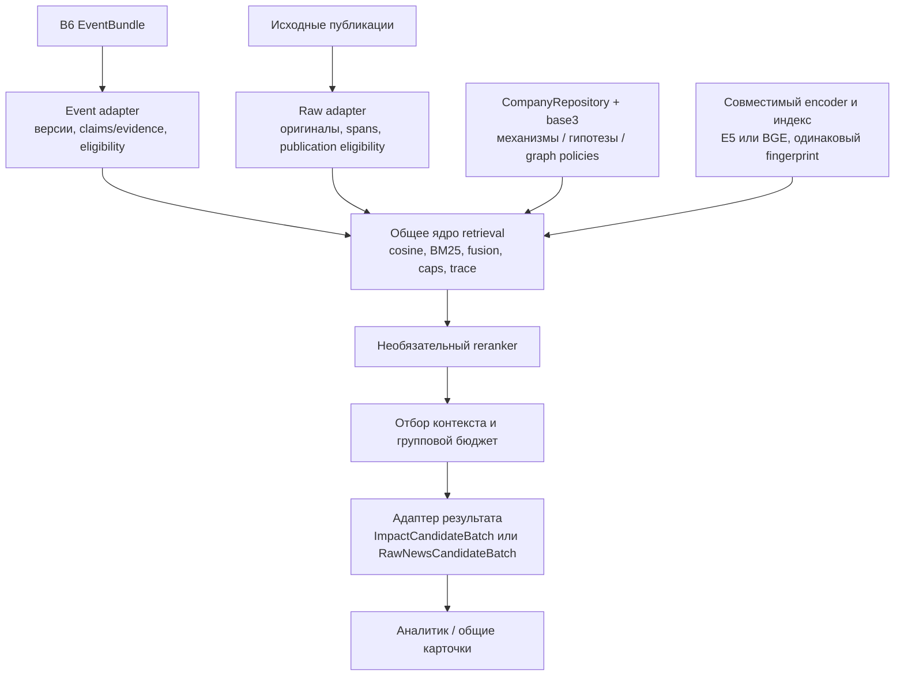

# Пересечение существующего retriever и нового GPU-эксперимента

Проверена локальная ветка `news-pipeline-gpu-lazy-retrieval`, код на базе
`3c5df74`. Это анализ реализации; рефакторинг и повторная оценка моделей не
выполнялись. Проверка актуальности других remote-веток в этот обзор не входит.

## Вывод

Существующий retriever не выполняет нашу смысловую кластеризацию новостей.
Однако новый company-news runner частично повторяет его задачу и алгоритмы
поиска релевантного материала для компании. Это параллельный экспериментальный
путь с общими компонентами, а не подключённый к RetrievalService новый backend.

Различать три операции:

- новость ↔ новость: похожие тексты, кандидаты на дубликаты, reading groups;
- компания ↔ событие/публикация: поиск материалов для конкретного профиля;
- компания + материалы → аналитический вывод: отдельная LLM-стадия.

Одинаковый математический инструмент cosine не делает эти задачи одинаковыми.
Наш semantic-модуль выполняет первую операцию. Оба retriever-пути выполняют
вторую. Аналитик выполняет третью.

## Сопоставление

| Часть | Существующий путь | Новый путь | Пересечение |
|---|---|---|---|
| Вход | EventBundle v0.2, версия события, claims/evidence | Оригинальная публикация, текст, дата, provenance | Разные единицы поиска |
| Компания | CompanyRepository + business/finance/trade_geo | Те же CompanyRepository и build_company_views | Код переиспользован |
| Encoder | Закреплённый E5-small CPU ONNX INT8 | Тот же E5 для baseline, BGE-M3 для GPU | E5 общий; BGE — дополнительный adapter |
| Кэш векторов | VectorCache, нормализованный текст | Тот же VectorCache, дополнительный exact-text key и размер1024 | Общее хранилище; разные политики ключей нужны |
| BM25 | search_lexical | Тот же search_lexical через RawLexicalIndex | Один движок, разные способы формирования запросов |
| Dense | search_dense, лучший chunk внутри event_id | exact_topk, публикации, batch запросов | Общая математика реализована отдельно |
| Fusion | fuse: max RRF внутри канала | family_fusion: max внутри family/channel, затем веса | Две реализации общей основы |
| Основания | Base3, условные темы, structured exposures | Base3 + явные mechanism/hypothesis queries | Частично общие, часть расширена |
| Structured channel | Отрасли, факторы B6, entity mapping | Отсутствует | Возможность старого пути не перенесена |
| Граф | Company snapshots, payment context, graph views | Challenger не запускался | Новый путь не заменяет эту функциональность |
| Отбор | union/pool/output caps, бюджет полного batch | Те же виды caps, отдельный бюджет тел и reserve | Похожие обязанности, разные политики |
| Reranker | Не подключён в RetrievalService | Cross-encoder с кэшем | Дополнительная стадия |
| Дедупликация/группы | Не объединяет разные event_id; опирается на B5 | Reading groups + exact-body suppression/expansion в G4 | Разные обязанности |
| Выход | ImpactCandidateBatch → старый analyst adapter | RawNewsCandidateBatch → raw adapter | Разные контракты обоснованы разным входом |
| Общая карточка и personal cache | Не являются задачей RetrievalService | Подготовлены отдельным lazy analyst слоем | Расширение после retrieval |

## Где находится фактический повтор кода

1. **Оркестрация поиска.** `retriever/service.py:RetrievalService.run` и
   `llm/event_pipeline/company_news/experiment.py:retrieve` отдельно вызывают
   каналы, объединяют hits и применяют ограничения. Новый runner не вызывает
   RetrievalService. Само размещение raw-модулей под retriever/ ещё не означает
   один общий runtime.

2. **Cosine/top-K.** `retriever/channels/dense.py:search_dense` и
   `retriever/raw_search.py:exact_topk` имеют отдельные циклы вычисления dot
   product, сортировки и top-K. Различия важны: старый путь сначала агрегирует
   chunks по событию, новый ранжирует публикации и использует batch запросов.
   Объединять следует численное ядро, сохраняя отдельную агрегацию единиц поиска.

3. **RRF и caps.** `retriever/fusion.py:fuse` и
   `retriever/raw_search.py:family_fusion` отдельно реализуют max reciprocal rank,
   взвешенную сумму, tie-breaking и отметки pool/union. Family — расширение
   политики агрегации; базовый алгоритм можно сделать общим.

4. **Финальный бюджет.** Старый service оценивает полный candidate batch через
   UTF-8 bytes/4; новый `company_news/selection.py` ограничивает байты исходных тел.
   Оба ограничивают контекст, но их численные бюджеты не эквивалентны. Общий
   budget selector должен сохранять явную политику и область подсчёта.

## Обнаруженные ограничения интеграции

**BM25 baseline изменён помимо encoder.** Старый `service.py` объединяет тексты
base3 и делает один BM25-запрос. Новый `experiment.py` ищет отдельно по каждому
query text и объединяет ранги. Один движок не означает одинаковую выдачу.

Проверено на синтетических текстах без моделей/API:

- документы: `credit = кредит ставка`, `trade = импорт таможня`,
  `mixed = кредит ставка импорт таможня`;
- запросы: `кредит ставка` и `импорт таможня`;
- объединённый BM25: mixed → credit → trade;
- отдельные запросы + max RRF: credit → trade → mixed.

Поэтому C2 в новом эксперименте — E5 hybrid по оригиналам с новой политикой
запросов, а не точное воспроизведение старого RetrievalService по B6. C2/G0
сравнивают encoder внутри нового пути. A_fusion контролирует способ fusion,
но не воспроизводит весь старый runtime.

**Объявленные ports ещё не являются общей точкой подключения.**
`RawDocumentIndexPort.iter_blocks` объявляет `(matrix, ids)`, а новый exact_topk
получает `(ids, matrix)` из локального generator. Конкретный raw index object
через этот protocol runner не использует. `PairRerankerPort.rerank` объявлен для
CompanyQuery/RawNewsDocument, тогда как CrossEncoder.rerank принимает тексты, а
runner вызывает score_pairs напрямую. До объединения CPU/GPU runtime эти
сигнатуры нужно согласовать и проверить общими adapter tests.

**Гарантии B6 нельзя заменить raw-контрактом без миграции.** Старый путь выбирает
последнюю доступную версию события, учитывает withdrawn/quality, временное окно,
received_at и ссылки на claims/evidence. Новый работает с фиксированным снимком
публикаций и publication as_of; историческая доступность профилей неизвестна.
Сохранение обоих форматов входа оправдано, потеря их специфических проверок — нет.

**Механизмы не начались с нуля.** Finance view уже содержал условные поисковые
темы, а structured channel связывал ставки с loan/leasing/deposit и FX с ВЭД.
Новый словарь делает механизмы отдельными запросами/family и добавляет правила,
но частично пересекается с этими основаниями. Activity catalogue и query_text
также переиспользованы из существующего эксперимента retriever.

**Поздняя дедупликация не восстанавливает полноту retrieval.** В raw-пути разные
публикации одного сюжета могут занимать места top50/pool100. Удаление точных
повторов на стадии G4 освобождает финальный бюджет, но не возвращает документы,
которые ранее не попали в пул. Старый retriever агрегирует chunks внутри event_id;
слияние публикаций одного события должно быть корректно выполнено до него в B5.

## Предлагаемое объединение

Сохранить один поисковый сервис с отдельными адаптерами источников и политиками:

Порядок переноса: согласовать ports → общее численное ядро → параметризованный
fusion → общий orchestration service → adapters контрактов и бюджета. Сохранить
golden outputs существующего B6-пути и проверить изменения на общих fixtures;
разницу рангов при намеренной смене политики фиксировать отдельно.

Если основной продукт выбирает путь через B6, использовать существующий
retriever как основу и переносить в него полезные расширения. Raw-путь сохранить
как отдельный режим/контроль для ещё не структурированных новостей. Ставить два
company-retriever подряд без отдельной измеренной цели не требуется.
