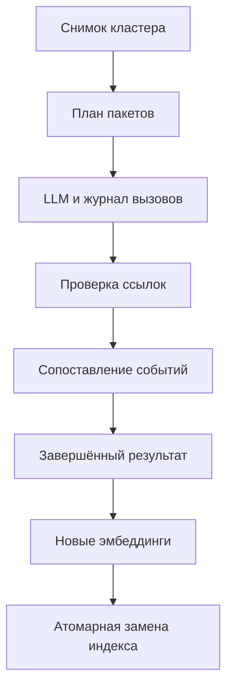

# Lazy cluster merge

Самостоятельный модуль, без импорта старых NLP-стадий. Python 3.13+, зависимости:

```bash
python -m pip install -r llm/cluster_merge/requirements.txt
python -m unittest discover -s llm/cluster_merge/tests -v
python -m llm.cluster_merge schemas llm/cluster_merge/schemas
python -m llm.cluster_merge plan request.json
```

## Контракт для ретривера

```python
from llm.cluster_merge import MergeService, OpenAIProvider, SQLiteQuota, MergeRequest

service = MergeService(OpenAIProvider(), SQLiteQuota("/shared/requests.sqlite3", 60))
request = MergeRequest.model_validate(payload)
plan = service.plan_merge(request)  # без сети
result = service.merge_cluster(request, max_calls=5)  # не более пяти новых вызовов
# service.resume_merge(result.operation_id, max_calls=5)
# service.get_merge_result(result.id)
```

Общий файл квоты должен использоваться всеми участниками эксперимента. Этот адаптер
не совместим автоматически с другими форматами журналов: другой общий шлюз подключается
объектом с методом `reserve(call_id)`. Без общего резервирования live-вызовы запрещены.
Это кредитный эксперимент; денежный production-шлюз реализуется отдельным лимитером.

Вход: `cluster_id`, строковая `revision`, `articles`, `trigger_id`, `profile`.
Каждая статья: уникальный неизменяемый `id` редакции, `text`, необязательные `title`,
`published_at`, `source`, `url`. Даты сохраняются как метаданные и не выводят дату события.
Профиль явно фиксирует endpoint, модель, reasoning, размер запроса в символах и выходной
лимит токенов. Символьная граница не заменяет подтверждённого токенного лимита провайдера.
Параметр thinking должен поддерживаться выбранным endpoint; автоматического fallback нет.

Кэш не зависит от компании, триггера и имени кластера. При смене триггера/ревизии
результат возвращает новые условия применения, но те же событийные объекты.
Изменение исходников или профиля создаёт новую операцию.

Только `completed` допускает замену индекса. Сначала кодируются **все** `embedding_text`,
затем под блокировкой/транзакцией проверяются ID, ревизия и хэш исходного состава,
и поисковые представления заменяются атомарно. Исходные новости остаются в архиве.
`example.py` демонстрирует это с заменяемой функцией encode; производственный индекс
и блокировки принадлежат ретриверу.

При `mode=merged` одно событие наследует место уже допущенной новости-триггера.
При `split` весь результат заново ранжируется; старый итератор кандидатов перестраивается.
При `unchanged` действует обычная логика ранжирования. Частичные результаты не применяются.

## Выполнение и ограничения

Все фрагменты — точные Unicode-срезы источников. Каждый абзац связан с их ID.
Полный исходный материал сохраняется в запросе операции, ссылки и координаты — в выходе.
Одна новость может относиться к нескольким событиям. Счётчики источников отражают
публикации, а не независимые подтверждения. Расхождения входят в объединённый текст.
Проверка ссылок не доказывает истинность или смысловую полноту текста.

Сначала выполняются пакеты, затем пары предварительных событий. После объединения
проверяются новые составы. Сопоставления получают исходники, не только пересказы.
Слишком большой контекст, неоднозначное перераспределение и исчерпание вызовов дают
явную неполноту. Модель не получает права объявлять разные события из-за длины.

Аренда 15 минут, heartbeat 30 секунд. Ответ сохраняется до применения. Неизвестный
исход, невалидный JSON, length, отказ, transport/HTTP-ошибка не повторяются автоматически.
Успешно сохранённый ответ повторно применяется без сети. При неизвестном исходе нужна
внешняя сверка; автоматического снятия резерва и команды повторной отправки нет.



Сеть через CLI требует `--max-calls`, `--quota-db`, `--quota-limit`.
Ключ — `LLM_API_KEY`; `.env` читается только CLI. Не сохраняйте ключ в JSON профиля.
Реальные вызовы не входят в обязательную приёмку. Качество объединения и потерю деталей
нужно измерять отдельно на ручном эталоне.
