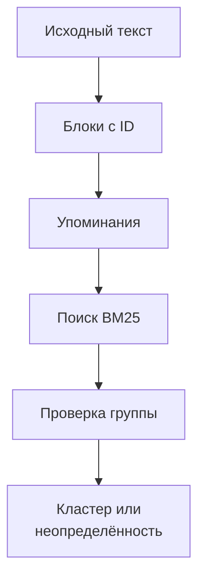

# Упоминания и кластеры событий

Экспериментальный модуль, независимый от SourceClaim и EventBundle.

## Текущий статус

Реализовано чистое ядро: модели, точные блоки, упаковка контекста,
терпимый разбор упоминаний, два представления BM25 и консервативный разбор
решений о принадлежности. Интеграция API, постоянное состояние, CLI,
экспорт и оценочный корпус пока не реализованы. Это ещё не готовый пайплайн.



Обязательны основания в исходных блоках. Дата, единица, участник,
модальность и пересказ могут отсутствовать. Существование основания
не доказывает истинность публикации и правильность пересказа.

`source_blocks` сохраняет Unicode-координаты. `packets` добавляет соседний
блок и содержательный заголовок. `parse_mentions` отклоняет отдельные записи
с неверными ссылками, сохраняя остальные. Сырой ответ должен сохраняться
будущим исполнителем, в том числе при некорректных необязательных полях.

`BM25Retriever.search` возвращает кандидатов и трассу ранжирования.
Оценка не является вероятностью идентичности. `parse_decisions` проверяет
полноту ответа и ссылки; `attachment` разрешает присоединение только при
одном `same` и отсутствии неопределённых конкурентов.

## Идентичность

Одно событие — конкретный выпуск, решение, действие или инцидент.
Разные заседания, периоды, авторы прогнозов, стадии и официальный пересмотр
образуют разные события. Разные числа одного установленного выпуска
могут быть противоречащими утверждениями об одном событии.

Два сообщения «ЦБ сохранил ставку» без установленного заседания —
неопределённая пара. Дата публикации не назначается датой события.
Прогноз решения и состоявшееся решение не объединяются.

## Проверка

```bash
.venv/bin/python -m unittest discover -s llm/event_pipeline/tests -v
```

Реальные API-вызовы в разработке не выполняются. Следующий этап — адаптер
существующих заданий и общего журнала квоты, затем каталог снимка и CLI.
