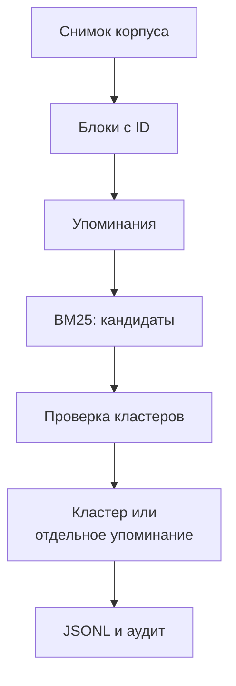

# Упоминания → поиск → кластеры

Новый экспериментальный пайплайн. Он сохраняет упоминания с неполными полями,
ищет похожие сообщения и проверяет принадлежность существующим кластерам.
Единица, дата, участник и пересказ могут отсутствовать. Обязательны исходные блоки
и происхождение. Существование блока не доказывает истинность публикации или
правильность её пересказа.

Это собственный контракт `event-pipeline.v1`, **не EventBundle**. Обогащение,
адаптер B6 и рекомендации компании сюда не входят. Старый B1–B6 остаётся baseline.



## Быстрый офлайн-запуск

Python 3.13+, зависимости уже закреплены в `llm/events/requirements.lock`.
Новых NLP-пакетов нет. Из корня репозитория:

```bash
python -m pip install -r llm/events/requirements.lock
python -m llm.event_pipeline check
python -m unittest discover -s llm/event_pipeline/tests
python -m llm.event_pipeline demo --output data/processed/event_pipeline/demo
```

Demo использует два синтетических сообщения без известной даты заседания.
Проверяющий провайдер имитируется: сообщения остаются раздельными с `uncertain`.
Это проверка соединения стадий, не качества настоящей модели. Повторный demo
требует нового выходного каталога; рабочие запуски возобновляются отдельной командой.

## Корпус и план

```bash
python -m llm.event_pipeline plan \
  --corpus data/processed/events/news-corpus-v1 \
  --document-ids data/processed/event_pipeline/pilot-v1/document_ids.json \
  --output data/processed/event_pipeline/pilot-run
python -m llm.event_pipeline status --run data/processed/event_pipeline/pilot-run
```

Без `--document-ids` выбирается весь корпус. План закрепляет исходные документы,
порядок, пакеты, профили и хэши реализации. Повтор того же планирования идемпотентен.
Изменённый состав, профиль или реализация требуют нового каталога запуска.
Изменение исходной статьи внутри базы заданий обнаруживается до обработки.

`--configuration` принимает JSON с `block_limit` (2000), `packet_limit` (8000),
`extraction_profile`, `verification_profile`. Профили используют существующую
модель ProviderProfile. По умолчанию оба режима **offline**. Нулевые тарифы и
тестовые границы используются только для учёта имитированных вызовов.
Настройки live требуют отдельного явно заданного профиля.

## Извлечение и кластеризация

```bash
python -m llm.event_pipeline extract --run RUN --responses extraction-responses.json --max-calls 10
python -m llm.event_pipeline cluster --run RUN --responses verification-responses.json --max-calls 10
python -m llm.event_pipeline resume --run RUN --responses remaining-responses.json --max-calls 10
python -m llm.event_pipeline retrieve --run RUN --position 1
```

Файл `--responses` — массив тел ответов Chat Completions с `choices`,
`finish_reason`, `message.content` и необязательным `usage`. Для каждого вызова
используется следующий элемент. Кэш не потребляет ответы и квоту.

После извлечения всех документов запускается кластеризация. `--allow-partial`
позволяет явно закрепить частичный набор. После этого извлечение в данном запуске
закрыто: добавление упоминаний требует нового запуска. При исчерпании лимита
вызовов сохраняется позиция; `resume` продолжает соответствующую стадию.

Один запуск допускает одного активного исполнителя. Запросы, ответы и расходы
сохраняет существующий B2/B3 через адаптер `runtime.py`. Каталог и контрольные
точки находятся в собственной SQLite-базе. Результат API записывается раньше
применения решения; авария между этими шагами не требует повторного запроса.
Ошибка формата не вызывает автоматического repair. Явный retry задания B2 не
переписывает уже закреплённую контрольную точку: для её пересмотра нужен новый запуск.

Принятые упоминания сохраняются после каждого пакета, даже если документ обработан
не полностью. Блоки, не помещающиеся с необходимым контекстом, отмечаются deferred.
Табличные заголовки сохраняются консервативно; сложные таблицы не реконструируются.

## Поиск и идентичность

BM25 использует два представления: основания с локальным контекстом и пересказ
с доступными подсказками. По 20 результатов объединяются RRF; проверяются до
восьми кластеров. Числа сохраняются. Нет обязательного фильтра по источнику,
категории или дате. Оценки и пропущенные при ограничении кандидаты входят в аудит.

Событие — конкретный выпуск, решение, действие или инцидент:

- Разные заседания, периоды, авторы/выпуски прогнозов и стадии не объединяются.
- Первоначальная оценка и официальное объявление пересмотра — разные события.
- Разные числа одного установленного выпуска допускают `same + conflicting`.
- Одинаковая тема или отсутствие даты не устанавливают идентичность.
- Прогноз и его реализация — разные события.

Проверяющий получает основания всех участников кандидатов, метаданные и прошлые
решения. Если контекст не помещается, проверка остаётся `unassessed`; участников
скрыто не выбрасываем. Присоединение разрешено при единственном `same` и остальных
`different`. Неопределённость и ошибки оставляют отдельное упоминание.

12 вручную заданных примеров находятся в `fixtures/identity_cases.json`.
Офлайн-тесты проверяют сохранение ожидаемых решений, а не способность LLM их выдать.

## Live и общий бюджет

Реальные вызовы при реализации не выполнялись. Для будущего эксперимента:

```bash
python -m llm.event_pipeline extract --run LIVE_RUN --live \
  --limits limits.json --journal EXISTING_SHARED_QUOTA.sqlite3 --max-calls 3
```

`limits.json` в кредитном режиме требует `{"live_enabled": true}`. Журнал должен
уже существовать: создание новой квоты и изменение её лимита здесь запрещены.
Используется тот же журнал, что у предыдущего эксперимента. Резерв расходуется
до отправки, включая таймауты и аварии. Неизвестная стоимость не выдаётся за ноль.
Без `--journal` действуют прежние production-проверки тарифов и лимитов.

Профили извлечения и проверки независимы, по умолчанию предполагается доступная
`deepseek/deepseek-v4.1-flash`, максимум ответа 4096, без скрытого переключения.
Форматы text/json_object/json_schema выбираются явно; JSON-режим и reasoning для
live требуют отметки предварительной проверки. Предлагаемая JSON Schema задаёт
оболочку без обязательных смысловых полей; конечная проверка выполняется кодом.
`.env` читается только live CLI; переменная окружения имеет приоритет.

## Экспорт и оценка

```bash
python -m llm.event_pipeline export --run RUN --output NEW_EXPORT_DIRECTORY
python -m llm.event_pipeline evaluate --run RUN --gold GOLD.json
python -m llm.event_pipeline evaluate-retrieval --documents DOCUMENTS.jsonl --gold GOLD.json
```

Экспорт содержит `mentions.jsonl`, `clusters.jsonl`, `decisions.jsonl`, `audit.jsonl`,
исходные документы, запросы/ответы, manifest с хэшами и `report.json`. Каталог
публикуется атомарно; существующий экспорт не перезаписывается. Непроверенные
упоминания включаются отдельными записями. Метка кластера — навигационный пересказ,
не подтверждённый общий факт. ID устойчивы внутри одного запуска, не между
разными пересборками. `complete` описывает завершённость обработки, не истинность
и не полноту извлечения; число неопределённых соответствий выводится отдельно.

Оценка использует только размеченные пары. Совпадение блоков измеряет локализацию,
а не правильность смысловых ролей. Precision возвращается только для явно заданных
`exhaustive_document_ids`; иначе `null`. Извлечение и поиск на ручных упоминаниях
оцениваются отдельно. Reasoning не добавляется повторно к выходным токенам.

Локальный пилот `data/processed/event_pipeline/pilot-v1/`: 43 документа,
76 выбранных упоминаний, 24 пары, `single_annotator_draft`. Исходные цитаты
проверяются по координатам; нужен второй проход для полноты фоновых упоминаний.
На ручных упоминаниях 6 из 6 подходящих случаев найдены поиском. Это маленькая
проверка retrieval, не качество LLM и не оценка всей системы.

## Карта кода

- `models`, `blocks`, `extraction` — независимые контракты и чистая обработка.
- `retrieval`, `clustering` — кандидаты и проверка решений.
- `runtime` — единственная граница с инфраструктурой старого пайплайна.
- `pipeline` — снимки, выполнение и возобновление.
- `output`, `evaluation` — экспорт и явно ограниченные метрики.
- `tests`, `schemas`, `fixtures` — воспроизводимая офлайн-приёмка.

Публичные Python-операции доступны из `llm.event_pipeline`: `plan_run`,
`extract_mentions`, `retrieve_candidates`, `cluster_mentions`, `resume_run`,
`export_run`, `evaluate_run`.

## Интерактивный просмотр

```bash
python -m llm.event_pipeline.report --export EXPORT_DIRECTORY --output report.html
```

Самодостаточный HTML открывается локально и передаётся команде одним файлом.
Слева — новости, в центре — упоминания, справа — кластеры. Выбор узла показывает
полный исходный текст с подсветкой оснований, метаданные, кандидатов и решения.
Тексты отображаются безопасно как данные, внешних библиотек и запросов нет.

## Эксперимент с эмбеддингами

Отдельный режим группировки исходных фрагментов по смыслу и времени:
[semantic/README.md](semantic/README.md). Не требует предварительного LLM-извлечения;
сохраняет векторы, два варианта групп и основания для будущей визуализации.
