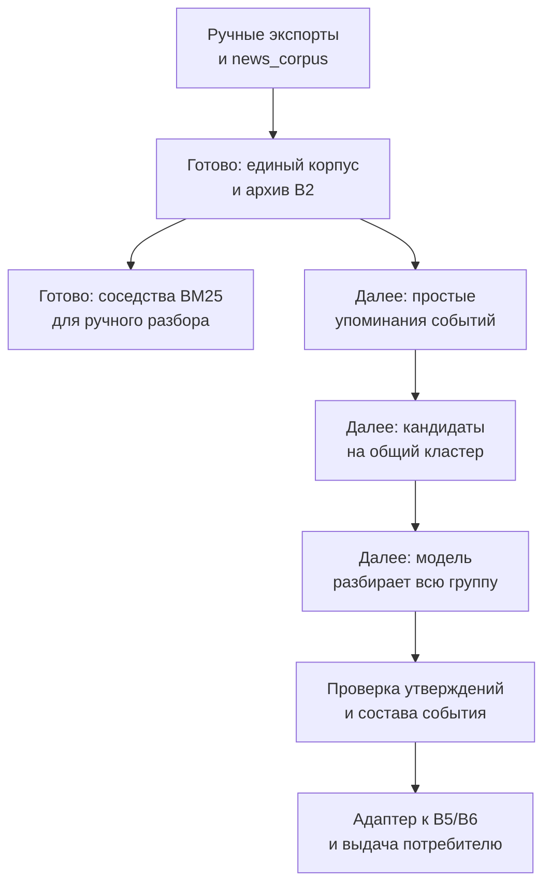

# Переход к извлечению на уровне группы новостей

Цель — сначала находить простые упоминания с высокой полнотой, затем совместно
разбирать похожие сообщения. Полная структура нужна финальному результату, а не
каждому раннему кандидату. Текущий B3–B6 сохранён как baseline.

## Что уже сделано

`corpus/prepare.py` читает JSON-экспорты Telegram Desktop и JSONL сборщика,
сохраняет точный текст и происхождение, проверяет ArticleInput. `corpus/neighbors.py`
строит предварительные соседства по BM25 для ручного просмотра. Это ещё поиск
кандидатов по статьям, **не новая модель извлечения и не установленные кластеры событий**.
Автоматический Telegram API-сборщик удалён; Telethon и авторизация больше не нужны.



## Подготовка данных без сети

```bash
python -m llm.events corpus prepare \
  --input data/raw_news --output data/processed/events/news-corpus-v1
python -m llm.events corpus neighbors \
  --corpus data/processed/events/news-corpus-v1 \
  --output data/processed/events/news-corpus-v1/review-18-21 \
  --start 2026-10-18 --end 2026-10-21 --max-groups 30
python -m llm.events storage \
  --db data/processed/events/news-corpus-v1/state.sqlite3 \
  import-batch data/processed/events/news-corpus-v1/articles.json
```

Файлы исходников и все выходы исключены из Git. Исходные файлы не переписываются.
Подготовка имеет manifest с хэшами входов, реализации, схемы и выходных файлов.
При одинаковом входе повтор возвращает cached; при изменении нужен новый каталог.
Предпросмотр соседств также создаётся в новом каталоге, чтобы не затереть разметку.

| Файл выхода | Для чего |
|---|---|
| `documents.jsonl` | ArticleInput + точные метаданные происхождения |
| `articles.json` | Батч для B2, если нет неоднозначных редакций одного article_id |
| `manifest.json` | Хэши и идентификатор подготовленного корпуса |
| `audit.json` | Источники, даты, повторы, размеры и ограничения |
| `rejected.json` | Все исключения с указателем на исходник |
| `review-18-21/neighbors.json` | Предварительные группы, score, конфигурация |
| `review-18-21/REVIEW.md` | Сокращённый просмотр, не вход модели |
| `review-18-21/documents.jsonl` | Полные тексты выбранных записей |

Одна запись Telegram получает ID `telegram:<числовой ID канала>:<ID сообщения>`.
Rich text склеивается из отображаемых строк без удаления пробелов, emoji и переносов.
Каждому фрагменту соответствует исходный JSON Pointer и Unicode-координаты. HTML,
медиа и содержимое ссылок не загружаются. Заголовок Telegram — техническая метка
сообщения, не выдуманный заголовок новости; её происхождение отмечено отдельно.
Язык Telegram не угадывается (`und`), полнота оригинала не утверждается.

Время Telegram берётся из `date_unixtime`, а исходная дата и сведения о редактировании
сохраняются рядом. Из единственного экспорта нельзя восстановить прежние тексты правок.
Дата без времени и datetime без timezone не превращаются в произвольную полночь:
`published_at=null`, исходное выражение и точность остаются в provenance.

Повторы по тексту отмечаются, но разные источники не удаляются. Полностью одинаковый
ArticleInput хранится одним документом со всеми наблюдениями происхождения. Несколько
редакций одного ID сохраняются раздельно; неоднозначный B2-батч автоматически не создаётся.

## Что показал корпус

На четырёх предоставленных файлах: 3697 записей, из них 3621 с текстом и 76 без текста.
РБК — 237 текстовых сообщений, ТАСС — 732, РИА — 207; сборный корпус — 2445 записей
из 23 источников. Всего 26 источников, 77 лишних вхождений полностью одинакового текста,
18 дат без времени. Telegram охватывает 18–21 октября; сборный корпус — июль–октябрь.

Данные достаточны для начала эксперимента и проверки пересечений, но не являются
размеченным эталоном. Источник moex_main занимает 1135 записей: случайная выборка
будет сильно смещена. Есть длинные страницы, общая навигация и списки множества новостей,
а дата в метаданных иногда расходится с календарной надписью внутри извлечённой страницы.
Наличие текста не означает качественное извлечение статьи.

Предпросмотр выбирает ограниченное число якорей от каждого источника, соседей других
источников в окне дат публикации, подавляет частые строки **только в поисковом представлении**.
Исходные тексты не меняются. BM25 без морфологии и эмбеддингов даёт тематические ложные
совпадения; score не вероятность одного события. Группы могут пересекаться.

## Следующие части новой системы

1. **Простое упоминание.** Описание события, ссылки на готовые фрагменты, необязательные
   участники/тип/время. Не требовать нормализованных чисел, всех временных ролей,
   единицы, JSON Pointer и полной разметки каждого поля. Ссылка и происхождение обязательны.
2. **Поиск кандидатов по упоминаниям.** Сравнить BM25 и семантическое представление
   на размеченных парах. Статейный baseline выше нужен для диагностики, а не замены
   этого шага: одна статья может описывать много событий.
3. **Разбор группы моделью.** Передавать упоминания вместе с исходными фрагментами и
   метаданными. Модель может разделить группу и отказаться от объединения. Сохранять
   утверждения каждого источника, обновления, сценарии и противоречия; не изобретать
   единое «правильное» число. Строгие единицы/роли вводятся здесь, когда они действительно нужны.
4. **Проверка и публикация.** Проверять точные основания и ссылки кодом. Согласовать
   адаптер результата группы с B4, каталогом и EventBundle, не переименовывая сырой
   кандидат в проверенный SourceClaim. Утверждение остаётся привязано к своему источнику.

Модель для разбора группы, формат её ответа и стоимость ещё не проверены. Вызовов
LLM на новом корпусе не было. Прежняя экспериментальная квота не сбрасывается.

## Как избежать подгонки

Сначала вручную разметить группы и отдельные упоминания: same/different/uncertain,
самостоятельные события, пропуски, прогнозы, сценарии и важные числовые роли.
Часть оставить для разработки; проверочную часть выбирать по семействам событий,
а не случайными отдельными публикациями. Пока семьи не установлены, split=unassigned.
Совпадающие тексты и сообщения об одном событии не должны попасть в разные части.

Нужны положительные примеры и трудные отрицательные: одна тема, но другие участники,
дата, решение или прогноз. Первые ручные метки имеют статус single_annotator_draft.
Не считать все непомеченные пары отрицательными. Измерять полноту упоминаний,
качество поиска, ложные объединения и правильность итоговых полей отдельно.
