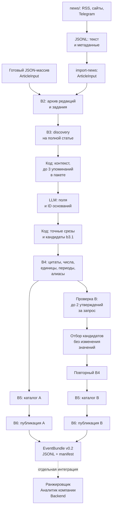

# Как новость проходит систему



LLM вызывается в discovery, предметных пакетах и только явно в проверке B.
Остальные блоки работают локально. Простой B3 (`llm run`) может получить b3.1
одним запросом вместо discovery и пакетов; его используют для отладки контракта.

## Что передаётся между стадиями

| Шаг | Вход | Выход |
|---|---|---|
| Сборщик | Ленты/страницы/Telegram | JSONL модели `news.core.model.Article` |
| Адаптер | JSONL с непустыми текстами | Батч `ArticleInput`, квитанция B2 |
| B2 | Батч + отдельно профиль обработки | `ArticleRecord`, source_id, задание/попытка |
| B3 | Конкретная редакция | `ExtractionResult b3.1`, локальные кандидаты |
| B4 | Явный ID B3-артефакта | `NormalizedArticleResult b4.1`, SourceClaim, отказы |
| B5 | Выбранные успешные B4-артефакты | Версионированный каталог событий |
| B6 | Опубликованный снимок B5 | `EventBundle v0.2`, происхождение и JSONL |

B3 назначает значения полей; точные цитаты и координаты вычисляет код по готовым ID.
B4 не удаляет существенные измерения для принятия ошибочного кандидата. Частичная
обработка и отказы остаются в аудите и влияют на качество B6. Пустая выдача не означает,
что в исходной статье нет фактов.

## Как подключён поток

```bash
python -m llm.events import-news data/processed/news/news_corpus.jsonl \
  --db data/processed/events/news.sqlite3
```

Адаптер пропускает пустые/невалидные записи, остальные сохраняет через обычный импорт B2.
Он не вызывает LLM. Наличие текста не доказывает его полноту: ставится
`is_full_original_text=false`. Если происхождение известно точнее, подготовить явный
ArticleInput JSON-массив и использовать `storage import-batch`. Автоматического
фонового исполнителя между сборщиком и NLP сейчас нет.

Задания, попытки, ответы и результаты сохраняются в SQLite. До dispatch резервируется
расход; неизвестный расход сохраняется после сбоя. Повторы и repair запускаются явно.
Реальный и офлайн-режимы различаются конфигурацией и ключами кэша.

## Где заканчивается ответственность модуля

B5 сохраняет разные сценарии, роли before/after и конфликтующие числа. B6 добавляет
нейтральный заголовок, метки для поиска и качество, но не выбирает «правильную цифру»
и не предсказывает влияние на компанию. Аналитик получает весь bundle.

Публикация явная. Если статья изменилась, нужно обработать новую редакцию и пересобрать
каталог; если изменился B5 — заново опубликовать B6. Текущие чтения возвращают
`catalog_stale`/`publication_stale`, история запрашивается явно.
