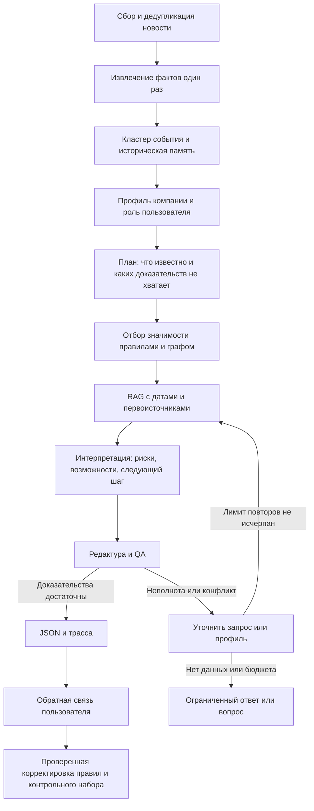

# Анализ кейса и план вашей части проекта

Дата: 20 октября 2026 года. Основание: локальный PDF задания, все три CSV, девять аналитических PDF, описание распределения задач и предоставленное пользователем описание SIGMA. Внешние рыночные факты и доступность API моделей этим исследованием не подтверждались.

**Рекомендация: взять в свою ответственность сервис интерпретации — собственный оркестратор, RAG по материалам банка, проверку доказательств и JSON ответа.** Для MVP достаточно двух LLM и инструментов на обычном Python. Основная сложность здесь — качество данных, временная согласованность источников и доказуемая персонализация.

Практическая заготовка уже создана: аудит CSV, OCR 64 страниц, 109 фрагментов с происхождением, локальный поиск, каталог документов, проект политики моделей и JSON Schema. Это подготовка к реализации; работающего LLM-агента, API и пользовательского прототипа пока нет.

## 1. Что на самом деле требуется

Продуктовая формулировка в три строки:

> Сервис в Альфа-Бизнесе помогает руководителю понять, какие внешние события важны именно его компании.
> Он соединяет новость, признаки бизнеса, наблюдаемые связи с контрагентами и датированную аналитику банка.
> Пользователь получает объяснение рисков и возможностей, следующий проверяемый шаг и источники каждого существенного вывода.

В задании целевая аудитория — крупный бизнес с выручкой **свыше 15 млрд рублей**, но пользователь — конкретный человек: финансовый директор, казначей, собственник и т. п. Одна компания может иметь несколько пользователей. Поэтому `company_id` и `user_role` — разные поля контекста. Роль нельзя восстановить из таблицы связей физических лиц: должностей там нет. Основание: PDF задания, страницы 4–5.

Необходим полноценный путь от выбора компании до интерпретации события, а также уточняющий вопрос и переход к источнику. Точка входа должна находиться на главном экране Альфа-Бизнеса. Статичных макетов недостаточно. Основание: страницы 8–10.

Критически важны:

- содержательный вывод из нескольких факторов: событие + конкретный признак клиента + относящаяся к вопросу аналитика;
- видимое разделение факта, позиции банка и предположения AI;
- собственная многошаговая агентная логика с инструментами и коррекцией процесса;
- прослеживаемость источников, признаков и промежуточных результатов;
- работа на новых, неполных и зашумленных входах;
- воспроизводимая сдача: GitHub с историей и фиксированной версией, README, Docker, фиксация зависимостей, notices, синтетические данные.

Один агент прямо разрешен; количество агентов само по себе не влияет на оценку. Внешний сервер рекомендован, но не сформулирован как обязательное условие. Нативная реклама разрешена, однако отдельного гарантированного балла за нее в перечне 01–12 нет. Не стоит отнимать у RAG и QA время ради рекламы. Основание: страницы 8, 13.

В PDF нет даты дедлайна, тарифов, численного дневного токен-лимита и адреса LLM API. Впоследствии проверен `data/context/messages.html`: организаторы уточнили 19 октября в 23:14, что денежный лимит — **500 ₽ в день на команду**, сброс в **00:00 МСК**, остаток не переносится; ключ перестает работать после завершения приема решений (message6151). Порядок live-проверки после отключения ключа в этой выгрузке не разъяснен.

Дополнения из HTML: локальные embedding-модели разрешены (message6094, message6151); следует ориентироваться на компании из предоставленной базы (message6172); тестовая интеграция с Альфа-Бизнесом недоступна, достаточно отдельного сайта в его стилистике с предусмотренной точкой входа (message6591); SDK `openai` разрешен как HTTP-клиент выданного API при использовании разрешенных моделей и собственной агентной логики (message6620). Это ответы организаторов, а не предположения других участников.

## 2. Что обнаружено в данных

Полный машинный результат: [data_audit.json](../data/processed/data_audit.json). Аудит прочитал все строки, а не выборку. Формат — UTF-8, разделитель `;`, продуктовые флаги записаны строками `0.0`/`1.0`.

| Файл | Размерность | Что это дает |
|---|---:|---|
| `df_Uid_data_hack.csv` | 85 525 строк, 24 поля, 85 514 уникальных компаний | Профили, продукты, отрасль, регион, выручка, группы |
| `df_Uid_payment_hack.csv` | 1 380 585 строк, 4 поля | Направленная наблюдаемая платежная сеть |
| `df_Fid_Uid_link_hack.csv` | 12 514 строк, 4 поля; 11 120 физических лиц | Дополнительные связи между организациями |

### Компании

**Коллизия идентификатора:** `U_428697` встречается 12 раз с различающимися отраслью, выручкой, группой, регионом и другими полями. Это 11 дополнительных строк, а не 11 разных конфликтных идентификаторов. Нельзя бездумно делать `drop_duplicates(keep="first")`: это создаст произвольный профиль. В MVP этот ID лучше исключить из демонстрационных компаний и пометить `profile_conflict` в загрузчике.

**Мало крупных компаний:** если `REVENUE_COMPANY` задана в рублях, порог 15 млрд проходят только **115 уникальных компаний**, из них **102 строки с `CL_TYPE=CLIENT`**. Единицы выручки в описании явно не указаны — это допущение необходимо подтвердить. Медиана сырого значения — 33 583 428, максимум — 105 596 467 908. Не следует показывать случайный небольшой бизнес как основной пример соответствия целевой аудитории.

**Пропуски и смысл признаков:**

- `AMOUNT_WORKERS_SPARK_GRADATION`: пропущено 85 357 значений, **99,80%**. Базовая численность — категории ФНС; СПАРК только дополнительный источник. Категория не дает точного числа сотрудников.
- `ECO_MARK_LABEL`: пропущено 4 157 значений, **4,86%**. Это стадия/тип развития, а не отрасль. Отрасль брать из ОКВЭД.
- `FTS_COUNTRY_NAME`: пропущено 77 179 значений, **90,24%**. Есть 224 строки с `FTS_FLAG=1.0` без страны. Список стран нужно разделять по запятым, очищать пробелы и сохранять исходное значение. Наличие ФТС не доказывает направление импорта/экспорта, валюту расчетов или долю международного бизнеса.
- `NEGATIVEMARK` в словаре кейса описан как признак ключевого собственника. По названию его нельзя переинтерпретировать как негативный риск. До уточнения семантики не использовать в скоринге.
- Возраст и численность — интервальные категории. Например, значение `8-15` нельзя превратить в утверждение «компании 12 лет».
- `GROUP_ID` заполнен, наблюдаются 18 098 значений и 5 229 групп более чем с одной строкой. Общая группа не доказывает поручительство или единый юридический риск; суммирование выручки не дает автоматически консолидированную выручку.

Профиль содержит 546 кодов ОКВЭД и 82 региона. Наиболее частые коды: `68.20`, `41.20`, `56.10`; это полезно для выбора первых отраслевых правил. `ORG_TYPE` одинаков во всех строках и почти не помогает ранжированию.

Наличие кредитного продукта отмечено в 4 945 строках, лизинга — в 15 011, депозитов — в 4 283, факторинга — в 213. Флаг продукта **не сообщает** остаток долга, плавающую ставку, дату пересмотра, срок погашения или свободную ликвидность. Нулевой флаг нельзя распространять на отношения клиента со всеми другими банками.

### Платежи и связи

В платежах **178 159 уникальных узлов**:

- **63 607** имеют профиль в таблице компаний;
- **114 552** не имеют такого профиля;
- **21 907** компаний из основной таблицы не встречаются в платежах;
- только **389 396 строк, около 28,2%**, имеют оба конца в основной таблице.

Следовательно, inner join по обоим концам уничтожит большую часть наблюдаемой сети. Нужен left join и «неполный узел»: известен ID и платежная связь, неизвестны отрасль и остальные атрибуты.

Есть **27 406 самопереводов** и **17 дополнительных строк повторяющихся направленных пар**. Самопереводы исключать из расчета внешней концентрации. Для повторов сначала выяснить, дубли это или отдельные агрегаты: суммирование без знания периода может завысить оборот.

Все `PAY_AMT` и `PAY_CNT` заполнены и положительны. Но **нет дат, валюты, окна агрегации и назначения платежа**. Поэтому нельзя утверждать, что платежи месячные, контрагент является поставщиком, связь недавно выросла или прекратилась. В первой версии писать «получатель платежей»/«плательщик» и «доля в наблюдаемой выборке».

Полезные вычисляемые признаки:

- исходящий/входящий объем и число платежей;
- top-5 контрагентов по каждому направлению;
- доля каждого контрагента в наблюдаемом потоке без самопереводов;
- концентрация top-1/top-5;
- доля потока к узлам с известным профилем;
- связи внутри `GROUP_ID` отдельно от остальных;
- факт пересечения события с известным узлом, а не выдуманное влияние неизвестной организации.

Пример формулы: `out_share(u,v) = PAY_AMT(u→v) / Σ PAY_AMT(u→w), w ≠ u`. Это доля наблюдаемых платежей, **не** доля закупок или себестоимости.

В связях физических лиц 7 885 строк ссылаются на компании вне основной таблицы; покрыто лишь 4 519 известных компаний. 969 физических лиц имеют более одной связи. Это слабый дополнительный сигнал связанности: данные не говорят, что человек собственник или директор.

**Невозможная без дополнительных данных интеграция:** реальное название из новости нельзя сопоставить с `U_123` по предоставленным файлам. В них нет названий компаний и ИНН. Для демо нужны явно синтетические сущности и таблица соответствий; для реального сервиса — разрешенный справочник entity resolution. DeepSeek не может восстановить отсутствующий ключ соответствия.

В приложении на странице 16 платежный файл ошибочно подписан именем файла связей ФЛ. Фактический платежный файл в папке — `df_Uid_payment_hack.csv`.

## 3. Что обнаружено в аналитических материалах

Все девять PDF не имеют извлекаемого текстового слоя: `pdftotext` вернул только разделители страниц. Выполнен локальный OCR `rus+eng`; обработаны **64 страницы**, получено **160 592 символа**.

| Материал | Страниц | Дата/период по содержимому | Использование |
|---|---:|---|---|
| `ALFA-7M26.pdf` | 4 | 07.09.2026 | Труд, зарплаты, потребление, ограничения предложения |
| `ALFA-Macro_Insights-Policy_Rate_11Sep.pdf` | 4 | 11.09.2026 | Ставка, риторика ЦБ, инфляционные риски |
| `ALFA-consumption.pdf` | 4 | 05.08.2026 | Спрос, розница, труд |
| `ALFA-macro_stat1H26.pdf` | 5 | 31.07.2026 | ВВП, инвестиции, макропрогнозы |
| `FI_Strategy_3Q26_22072026.pdf` | 27 | 22.07.2026 | Облигации, кредит, ДКП, ликвидность |
| `Gold_digest_August26.pdf` | 8 | Обзор августа 2026; точная дата выпуска не установлена | Золото; внутри есть данные на 07.09 |
| `Inflation_tracker_02.pdf` | 3 | 02.09.2026 | Недельная инфляция, топливо |
| `Бонд_Бриф_14092026.pdf` | 5 | 14.09.2026 | Ставка, долговой рынок, новости эмитентов |
| `ALFA_Russian_Steels_1К21PreviewUpdate_15Apr2021.pdf` | 4 | **15.04.2021** на первой странице | Только исторический контекст |

Отдельного файла с названием «Commodities performance», перечисленного на странице 17 задания, в папке нет. Есть золото и старый обзор стали; считать их полной заменой нельзя. Текущую аналитику по недостающим товарным рынкам агент должен обозначать как отсутствующую.

Существенные ловушки для RAG:

1. **Изменение прогноза.** На странице 1 июльской макростатистики прогноз ставки на конец 2026 года — 13,5%; на странице 1 материала 11 сентября он пересмотрен до 14%. Это обновление оценки по одному горизонту. Последний документ в доступном корпусе имеет приоритет при вопросе о более позднем состоянии, а прежний прогноз сохраняется как история. Для исторического вопроса нельзя подмешивать будущие документы.
2. **Смешение даты содержания и оформления.** На первой странице обзора стали — 2021 год, но последний лист содержит дисклеймер 2026 года. Дата футера не должна делать отраслевой прогноз актуальным.
3. **Период обзора не равен дате публикации.** В «августовском» золоте есть данные на 7 сентября. Нельзя присвоить ему дату 31 августа и использовать в историческом сценарии на конец августа.
4. **Смена экономической оценки.** Июльский/августовский материалы говорят об охлаждении рынка труда; сентябрьский — что данные не подтверждают охлаждения. Это повод сравнить период и аргументы, а не усреднять формулировки.
5. **OCR чисел и таблиц.** Видны распознавания `1П26 → 11126`, `0,1 → 01` и смешение подписей графика с абзацами. Наличие citation само по себе не доказывает правильность числа.

Первая страница материалов по ставке, ВВП и стали дополнительно просмотрена как изображение. Остальной корпус обработан OCR и просмотрен по извлеченному тексту/структуре; сплошной визуальной верификации каждой цифры не было. Ни один OCR-чанк автоматически не помечен полностью проверенным.

Все экономические утверждения выше описывают **предоставленные материалы кейса**, а не независимо проверенную текущую ситуацию в экономике.

## 4. Ваша зона ответственности и границы с командой

Нумерация в переписке противоречива: интерфейс называется задачей 2, но далее фронт назван ролью 4; «контекст из роли 2» фактически описан в задаче 4. Чтобы не потерять интеграцию, фиксировать владельцев по названию компонента и имени человека.

| Компонент | Кто отвечает по содержанию задач | Что нужно согласовать с вами |
|---|---|---|
| Профиль и граф | Исполнитель задачи 4 | `CompanyContext`, качество полей, top-контрагенты, происхождение признаков |
| UI | Исполнитель задачи 2 | `InsightResponse`, состояния загрузки/ограничений, ссылки, уточнения |
| Демо, QA, Docker, deployment | Исполнитель задачи 3 | Новости и ожидаемые результаты, единый запуск, учет бюджета |
| Продукт и координация | Исполнитель задачи 5 | Allowlist/API, критерии, дедлайн, единый контракт, приемка |
| Агент, RAG, LLM, доказательства | **Ваша часть** | Входы, выходы, тесты, ограничения и стоимость |

В вашей формулировке не закреплен владелец **парсера внешних новостей**, хотя он требуется на странице 6. Предложение: инфраструктурный исполнитель делает fetch/RSS/хранение, вы задаете контракт события, классификацию и извлечение фактов. В MVP достаточно одного согласованного внешнего источника плюс загрузка нового синтетического текста. Это решение нужно закрепить явно.

**Переформулированная ваша задача:**

> Реализовать сервис, который принимает нормализованное событие, версионированный профиль компании и роль пользователя; самостоятельно планирует поиск, извлекает датированные доказательства из аналитики банка, строит условную персонализированную интерпретацию и возвращает проверенный JSON с источниками, использованными признаками, ограничениями, трассой и стоимостью. При неполноте сервис выполняет ограниченный повторный поиск или задает уточнение. Все LLM-вызовы проходят через allowlist и общий бюджетный шлюз.

**Готовность вашей части:** новая новость проходит этот процесс без правки кода; два профиля дают разные объяснения; устаревший источник не становится текущей позицией банка; источник открывается на нужной странице; недостающие условия кредита явно неизвестны; исчерпание бюджета не запускает дополнительные вызовы.

## 5. Какие модели выбрать

Список подтвержден страницей 18 задания. Это подтверждение **разрешенности**, а не доступности deployment, цены или фактического качества. Точные `model_id` провайдера, поддержку JSON и vision нужно выяснить через выданный API. Маркетинговое имя нельзя автоматически превращать в API ID.

| Разрешенная модель | Решение для MVP | Обоснование |
|---|---|---|
| **Qwen3.6 35B A3B** | Основной кандидат для классификации и извлечения фактов | Один структурированный результат на новость, повторное использование для разных клиентов |
| **Gemma 4 26B A4B** | Альтернатива после небольшого сравнения | Заменить Qwen, если лучше стоимость/качество на ваших данных |
| **GLM-5.3-Flash** | Кандидат для интерпретации и исправления по QA | Сложные связи, условные выводы, сопоставление нескольких источников |
| **DeepSeek-V4.1-Flash** | Выключен по умолчанию | Возможная сложная интерпретация уже вычисленного графа; обход графа и агрегаты делает код |
| **Qwen3-VL-30B-A3B-Instruct** | Только по необходимости | Проверка нужного графика/таблицы; не отправлять все 64 страницы в vision |
| **Kimi-K2.6** | Не включать отдельным шагом сначала | Редактура шаблоном и основным генератором дешевле; отдельная модель требует доказанной пользы |

Размер активных параметров не определяет тариф, задержку и качество русского JSON. До бенчмарка корректно говорить «кандидат», а не «дешевле/лучше».

Предлагаемый мини-бенчмарк: 10–15 разнообразных коротких новостей для сравнения Qwen/Gemma по валидному JSON, извлечению даты, участников, чисел, отсутствию добавленных фактов и цене. На 5–10 комбинациях «событие × клиент» проверить GLM по человеческой рубрике. Если стоимость тестов не помещается в выделенную квоту, уменьшить набор, сохранив неполноту, дубль и противоречие. Не запускать сравнение до проверки тарифов и остатка.

В [model_policy.json](../llm/agent/model_policy.json) зафиксированы список, предлагаемые роли и неизвестные параметры. Все маршруты пока выключены; это проект конфигурации, не действующее ограничение API.

## 6. Собственная агентная логика

Пользователь предоставил описание SIGMA: мониторинг внешнего контекста, нормализация и объединение событий, историческая память, оценка влияния, адаптация под пользователя, редактура, QA, доставка и обратная связь. Ниже эти принципы адаптированы под кейс. Подробное соответствие — [SIGMA_MAPPING_RU.md](SIGMA_MAPPING_RU.md).

В исходном SIGMA упомянут LangChain. В нашем MVP предлагается собственный оркестратор на Python: так команда реализует планирование, инструменты, состояние и адаптацию самостоятельно, как требует страница 18. PDF не формулирует отдельный запрет на любую утилиту LangChain, но заимствовать готовый агентный runtime в качестве основного компонента нельзя.

Начать с одного собственного оркестратора — state machine на Python. Поиск, граф, дедупликация и валидация — инструменты; не каждый этап обязан быть отдельным LLM-агентом.

**Инструменты:** `load_company_context`, `get_payment_neighbors`, `fetch_news`, `deduplicate_event`, `load_event_history`, `compare_event_versions`, `search_bank_analytics`, `read_source_page`, `validate_claims`, `reserve_budget`, `record_usage`, `persist_artifact`, `record_feedback`. У всех вход/выход со схемой; никакого произвольного shell или SQL из ответа LLM.

| Этап | Исполнение | Сохраняемый результат |
|---|---|---|
| Сбор | Код: источник, время, текст, canonical URL/hash | `RawNews` |
| Факты | Классификатор: тема, участники, даты, числа, утверждения | `EventFacts`, цитаты из новости |
| История | Код группирует сообщения и сравнивает версии; LLM — только для спорного сопоставления | `EventCluster`, `EventDelta`, ссылки на прежние факты |
| Контекст | Инструмент профилей, исключение конфликтных записей | `CompanyContext@version`, `missing_fields` |
| План | Выбор вопросов и инструментов по событию и пропускам | `AnalysisPlan` с проверяемыми вопросами |
| Значимость | Эвристика + граф; LLM только для спорной семантики | `RelevanceAssessment`, причины и признаки |
| Поиск | Два-три целевых запроса, даты, темы, 3–5 фрагментов | `EvidenceBundle`, версии/конфликты |
| Интерпретация | GLM на ограниченном контексте | `DraftInsight` с атомарными утверждениями |
| Редактура | Код/шаблон; без внесения новых фактов | `EditedInsight` |
| QA | Схема + ссылки + числа + даты + обоснованность | `QAReport`, список исправлений |
| Адаптация | Новый поиск, запрос профиля либо уточнение | `RetryDecision` |
| Выдача | Формирование контракта и журнала | `InsightResponse`, `UsageRecord` |
| Обратная связь | Оценка пользователя, затем разбор экспертом | `FeedbackRecord`, версия исправления |

Просто последовательность фиксированных промптов слабее требуемой агентности. План должен реально влиять на исполнение: для новости о контрагенте вызвать граф, для смены ставки — поиск макроаналитики, при двух прогнозах — запрос по горизонту и дате. В трассе должно быть видно, какой пробел инициировал повторный поиск и что изменилось после него.

**Ограниченный цикл:** максимум два дополнительных поисковых прохода и одна повторная генерация. При `missing_evidence` менять запрос/источник; при `conflicting_dates` сравнить дату публикации, горизонт и показатель; при `profile_missing` загрузить профиль или задать вопрос. Если данные отсутствуют, завершать `insufficient_evidence`/`needs_clarification`. Противоречие нельзя «разрешать» выдуманным усреднением.

Состояние запуска: `run_id`, `company_id`, `user_role`, `as_of`, `profile_version`, `event_id`, план, текущие факты, evidence, конфликтующие утверждения, черновик, QA, счетчики повторов, бюджет. Хранить в SQLite/другом командном хранилище, с изоляцией по компании и пользователю. Достаточно сохранять решения и результаты инструментов; скрытые внутренние рассуждения модели не нужны.

**Историческая память SIGMA — отдельная от состояния одного запуска сущность.** Сохранять кластеры событий, версии фактов и прежние опубликованные инсайты. Повторная публикация того же факта — дубль; новый факт по прежней теме — продолжение; усиление/затухание — классификация с доказательствами. При первом наблюдении возвращать `new`, не выдумывая историю. Предыдущий AI-вывод не становится первоисточником: сравнение должно вести к старым и новым документам/фактам.

Практический MVP истории: связать июльский и сентябрьский прогноз одного показателя на конец 2026 года; вывести «оценка изменена с 13,5% до 14%» с обеими датами. Это изменение прогноза, а не изменение самой ключевой ставки. После рестарта история должна сохраняться. Для хранения пока достаточно SQLite и файлов с хэшами; S3-совместимое хранилище из SIGMA — дальнейший вариант.

Для ранжирования начать с объяснимой эвристики: отраслевое соответствие, совпадение контрагента, относительный вес связи, продуктовая чувствительность, география, время события, качество доказательств. Весовые коэффициенты — версия конфигурации, а не обученная «вероятность риска». При неполном профиле снижать определенность, а не автоматически объявлять новость незначимой. Нужна ручная разметка пар «клиент–событие».

## 7. RAG: что уже работает и что довести

Реализовано:

- OCR страниц локально, без обращения к LLM;
- SHA-256 исходных PDF и текста фрагментов;
- ID фрагмента, номер PDF-страницы, символьные границы в OCR-тексте;
- черновые чанки до 2 200 символов с перекрытием до 250;
- ручной каталог дат, тем, служебных страниц и исторического материала;
- простой BM25 с нормализацией префиксов русских слов;
- фильтры темы, `as_of`, истории и служебных страниц.

Всего 109 чанков. 84 допускаются после исключения служебных страниц; 76 — в обычный поиск без исторического материала. Все имеют `verification_status=pending_review`.

Это работающий **поисковый baseline**, а не законченный RAG-сервис. Он не создает ответы, не проверяет все числа и не умеет читать графики. В запросе о ставке старый июльский прогноз оказался выше сентябрьского; значит, одного BM25 недостаточно для выбора текущей позиции.

Довести последовательно:

1. **Очистить структуру.** Отделить абзацы, таблицы, графики, подписи и футеры. Для 64 страниц ручная разметка важных разделов реалистична. Полные страницы-дисклеймеры исключены уже сейчас; повторяющиеся футеры внутри полезных страниц еще остаются.
2. **Чанки по смыслу.** Один тезис/пара связанных абзацев; не отрывать показатель от единицы, горизонта и оговорки. Таблица — с заголовками строк/колонок и единицами, а не линейная OCR-каша. Текущие 2 200 символов — техническая заготовка, не универсальный optimum.
3. **Проверить опорные факты вручную.** Для MVP достаточно 15–25 тщательно проверенных фрагментов по ставке, инфляции, труду, спросу, ВВП и золоту. Сохранить отмеченную область страницы для спорных чисел. В текущей версии есть page anchor, но нет bbox.
4. **Проверять время.** Сопоставлять `published_at`, `reference_period`, `forecast_horizon`, `as_of`, `supersedes`. Более новый документ не заменяет старый во всех вопросах: должны совпадать показатель, горизонт и область применимости. Неизвестная дата — явное ограничение; в историческом фильтре такой документ исключать.
5. **Развести авторство утверждений.** Внутри банковского PDF могут быть факт Росстата, цитата ЦБ, мнение аналитика и прогноз. Только последние два в соответствующем контексте могут поддерживать `bank_view`; весь текст PDF не является единым мнением банка.
6. **Гибридный поиск — после baseline.** Сначала BM25+тематические словари и временное ранжирование. Если согласован embedding endpoint, добавить один русскоязычный/мультиязычный encoder, фиксировать ID, версию, размерность и режим нормализации. Считать векторы один раз, объединять dense/BM25 через RRF, затем отбирать небольшой evidence bundle.

В HTML организаторы прямо разрешили локальные embedding-модели, включая multilingual-e5 (message6094, message6151); ограничение списка касается генеративных LLM. Можно добавить локальный encoder после выбора и оценки качества, зафиксировав его версию и лицензию. Конкретная embedding-модель пока не использована. Допустимость отдельного neural reranker этими ответами прямо не уточнена. Для 109 чанков не нужны отдельный векторный сервер и сложная инфраструктура.

Связь вывода с источником:

`claim_id → source_id → chunk_id → document_sha256 → PDF page + OCR offsets`

Для персонализации добавляется:

`claim_id → feature_id → field / graph_aggregation → input_file_sha256 + source_record`.

Ссылка означает возможность проверки, но не доказывает логическое следование. QA отдельно проверяет, что цитата действительно поддерживает тезис.

**Доверие к источникам из SIGMA:** ввести версионируемый реестр `source_id → source_type, trust_tier, rationale`. Первоисточник события, пересказ и экспертный прогноз имеют разную роль. Вес использовать при ранжировании evidence, но не как «вероятность истинности». Несколько перепечаток одной новости не считаются независимыми подтверждениями; высокий вес не отменяет проверку даты и смыслового соответствия.

## 8. JSON-контракт и объяснение пользователю

Проект схемы: [insight.schema.json](../llm/agent/contracts/insight.schema.json). Пример: [insight.example.json](../llm/agent/contracts/insight.example.json). Это версия 0.1 для согласования, не утвержденный командой API.

Ключевое решение — **атомарные утверждения с собственными источниками**, а не один список ссылок на всю карточку:

- `kind=source_fact` — факт из конкретного источника;
- `kind=bank_view` — позиция/прогноз из банковской аналитики, обязательно с датой;
- `kind=ai_inference` — вывод для компании с `feature_ids` и условиями.

Секции: `what_happened`, `why_important`, `risk`, `opportunity`, `next_step`, `bank_view`. Пустая секция допустима: отсутствие доказанной возможности лучше искусственно придуманной. Статусы ответа должны поддерживать недостаток данных и бюджета, а UI — отображать их.

Блок `changes_since_previous`: статус истории (`new`, `continuation`, `escalation`, `deescalation`, `unknown`), `previous_insight_id`, краткое описание и `claim_ids` доказательств изменения. «Нет истории» и «ничего не изменилось» — разные состояния. Для сравнения включать в `sources` обе версии первоисточников. Перед доставкой `ready` должен пройти QA; ограниченный ответ разрешен только после проверки его корректности и явного обозначения пробелов.

Вход `CompanyContext`:

- ID, версия профиля, `as_of`, выбранная пользователем роль;
- отрасль/ОКВЭД, регион, выручка с единицей и источником, категории возраста/численности;
- продуктовые флаги с узкой семантикой и качеством;
- наблюдаемые связи, доли потоков, покрытие графа, период/валюта или `unknown`;
- `missing_fields`, `conflicts`, `synthetic`, источник каждого признака.

Не передавать модели все 1,38 млн платежных строк. Передавать рассчитанные признаки и несколько релевантных связей. Не добавлять необоснованную «долю рынка» — для нее нет знаменателя рынка.

Вход `NewsEvent`: ID, версия, текст, источник, дата публикации/события, язык, сущности, темы, extracted facts, качество и synthetic flag. Автор новости и надежность источника — отдельные от уверенности LLM понятия.

Предлагаемые точки API: `POST /insights` для запуска, `GET /runs/{run_id}` для статуса и результата, `POST /insights/{id}/questions` для уточнения, `GET /sources/{id}` для разрешенного просмотра. Это предложения, сервер не реализован.

JSON Schema проверит структуру, но не существование `source_id`, принадлежность источника компании и поддержку утверждения. Нужен второй валидатор бизнес-инвариантов: уникальные ID, отсутствие висячих ссылок, разрешенные источники, даты, числовые единицы, условия выводов, статус OCR. Нельзя считать ответ готовым только потому, что JSON распарсился.

Для UI: отдельные подписи «Факт», «Позиция Альфа-Банка от …», «Вывод AI для вашей компании»; раскрываемое «Почему важно» с конкретными признаками; источники открываются на странице. Уточняющий вопрос должен использовать исходный evidence bundle и при необходимости запускать новый поиск, а не отвечать из памяти модели.

## 9. Как показать персонализацию

Для основного демо выбрать 2–3 компании из предоставленного CSV: организаторы подтвердили эту ориентацию в message6172. Профили строить из их реальных обезличенных строк, не заменяя измеренные признаки выдуманными. При необходимости дать синтетические отображаемые названия с явной маркировкой. Ниже — **дополнительные синтетические тестовые профили**, полезные для проверки различий поведения:

| Компания | Доступные признаки | Реакция на одно событие о ставке |
|---|---|---|
| Производитель, выручка 22 млрд ₽ | Есть кредит и лизинг; параметры договоров неизвестны | Сценарий сохранения стоимости нового/пересматриваемого финансирования; спросить тип ставки и ближайшие пересмотры |
| Торговая компания, 30 млрд ₽ | Есть депозит, нет отмеченного кредита; ликвидность неизвестна | Проверить сроки размещения и потребность в ликвидности; не обещать конкретную доходность |
| Логистика, 18 млрд ₽ | Есть лизинг; концентрация наблюдаемых поступлений у одного контрагента | Для новости о ставке — условная чувствительность; для события по контрагенту — концентрационный риск по наблюдаемым платежам |

Профили в [synthetic_profiles.json](../data/examples/synthetic_profiles.json) — примеры для согласования, не восстановленные реальные компании.

Хороший вывод: «В профиле отмечен кредитный продукт. В материале банка от 11 сентября ожидание ставки на конец года пересмотрено до 14%. Если стоимость вашего долга пересматривается вслед за ключевой ставкой, прежний сценарий удешевления обслуживания требует проверки. Уточните долю плавающего долга и даты пересмотра».

Плохой вывод: «Ваши процентные расходы вырастут на 10 млн ₽». В данных нет ни долга, ни типа ставки, ни срока. Также из сохранения ключевой ставки нельзя автоматически вывести рост договорной ставки.

Предлагаемый демонстрационный маршрут:

1. Выбрать компанию и роль финансового директора.
2. Открыть одно событие о ставке: показать признаки, датированную позицию банка и условный вывод.
3. Переключить компанию на депозитный профиль и показать изменившееся объяснение.
4. Открыть источники и трассу пересмотра июльского прогноза сентябрьским.
5. Спросить: «А если ставка по нашему кредиту фиксированная?» Ответ должен скорректировать область применимости, а не настаивать на росте текущих платежей.
6. Подать новый текст, которого не было на демонстрации; показать дедупликацию/новый анализ.
7. Подать событие о синтетическом контрагенте и показать рассчитанную платежную связь.

Замена роли должна менять акцент: казначейству — ликвидность/сроки, директору — спрос/инвестиции. Не обещать полноценную персонализацию по пользователям, если роли лишь переключают заголовок.

## 10. Бюджет 500 ₽ в день на команду и токен-лимит

Вызовов к хакатонному LLM API в этой работе не было. Поэтому фактический расход **этого ключа — 0 ₽ и 0 API-токенов**. Это не утверждение о стоимости работы самого помощника в чате.

Без тарифов и дневного лимита нельзя честно рассчитать количество доступных инсайтов.

Для модели `m`:

`cost = (input_tokens × price_input_m + output_tokens × price_output_m) / 1_000_000`.

Если провайдер отдельно считает cached input, reasoning или vision, добавить соответствующие тарифицируемые единицы. Использовать фактический `usage` провайдера и его валюту, а не условное число символов.

Предлагаемый конверт **на один день для всей команды**, а не дополнительный бюджет вашей роли:

| Назначение | Потолок |
|---|---:|
| Проверка API и сравнение моделей | 50 ₽ |
| Разработка и отладка | 150 ₽ |
| Контрольный набор и интеграция | 100 ₽ |
| Демо и резерв | 200 ₽ |

Это организационное предложение. При общей дневной квоте нужно согласовать доли участников. Согласно message6151, дневной денежный лимит сбрасывается в 00:00 МСК, остаток не переносится. Совокупный расход за несколько дней может превысить 500 ₽; его следует учитывать отдельно.

Технический контроль:

1. Все обращения команды — через один серверный шлюз; ключ отсутствует во фронте и логах.
2. До вызова транзакционно резервировать верхнюю оценку входа и `max_output_tokens`, проверяя общий бюджет и дневной токен-лимит. Для параллельных запросов учитывать и уже зарезервированные суммы.
3. После ответа сверять резерв с фактическим usage; timeout не означает бесплатный запрос. Не освобождать спорный расход без учета возможного биллинга.
4. Отдельно ограничить retries, число вызовов на запуск, выходные токены и vision.
5. Неизвестные тариф/остаток/лимит → live-вызовы отключены до конфигурации; режим подготовки и сохраненные результаты доступны.
6. Денежный дневной reset настроить на подтвержденные 00:00 МСК. Численный токен-лимит и правила его учета дополнительно сверить с конфигурацией API; не выводить их из денежного лимита.

Экономия: извлекать факты один раз на уникальную новость; дешево отбирать события до генерации; кэшировать RAG и итог по `(event_version, profile_version, user_role, corpus_version, prompt_version, model_id, as_of)`; предварительно рассчитывать демо для известных входов, но сохранять возможность нового live-события в оставшемся бюджете.

Рабочий ориентир для теста, не гарантия: extraction до 2–3 тыс. входных и 400–600 выходных токенов на новость; интерпретация до 4–6 тыс. входных и 800–1 200 выходных на пару «событие–компания». Измерить токенизатором провайдера, затем уменьшать по результатам качества. Отдельный LLM-редактор и LLM-судья на каждом шаге способны удвоить расход.

## 11. Безопасность и трассируемость

Это прямое ограничение кейса, страница 12; для прототипа достаточно обоснованной архитектуры, но ее нужно показать.

- Авторизация по пользователю и компании перед доступом к профилю, платежам и источникам. `company_id` из запроса сам по себе не является разрешением.
- Внешний текст и OCR — данные, а не инструкции. Команды «игнорируй правила» внутри новости не управляют инструментами.
- Только разрешенные read-only инструменты; модель не выполняет платежи, заявки и изменение клиентских данных.
- Ограничить домены/протоколы внешнего fetch, размер и время загрузки; запретить обращение к внутренним адресам через URL новости.
- Передавать LLM минимальный профиль и агрегаты; не отправлять весь граф и лишние связи ФЛ.
- Логировать ID, версии, хэши, параметры разрешенного инструмента и usage; не секреты. Трассы и ответы тоже разделять по доступу.

Минимальный TraceEvent: `run_id`, `step_id`, timestamps, tool/model ID, prompt/schema version, входные artifact IDs, выходные artifact IDs, использованные источники/признаки, duration, usage, QA code, retry reason.

Журнал должен позволять воспроизвести **основание вывода**. Хранить скрытые рассуждения модели или представлять их пользователю не требуется.

## 12. Проверки и метрики

Указанные ниже пороги — предлагаемые цели команды; организаторы численных порогов не дали.

| Проверка | Как измерять | Предлагаемая приемка MVP |
|---|---|---|
| Значимость | Разметка 0–3 для пары «клиент–событие», nDCG@5/Precision@5 | Лучше неперсонализированного порядка на отложенных событиях |
| Retrieval | Вопрос → эталонные страница/абзац, Recall@5 | ≥0,85 на отдельном небольшом наборе; объем и ошибки раскрыть |
| Трассируемость | Доля существенных claims с существующими источниками и признаками | 100% структурной связности; отдельно смысловая поддержка |
| Фактологичность | Человек проверяет числа, даты, участников и причинность | 0 критических неподдержанных утверждений в приемочном наборе |
| Позиция банка | Нет AI-совета, помеченного банковской рекомендацией | 0 случаев смешения авторства |
| Адаптация | Новые запросы при искусственной неполноте/конфликте | Повтор с понятной причиной либо честный отказ; без циклов |
| Полнота | Заполнены применимые части карточки или есть объяснение отсутствия | Все применимые поля; не поощрять выдуманные риски/возможности |
| Стоимость | usage всех шагов, retries и неудач / число принятых инсайтов | Не превышает выделенную командную квоту |
| Скорость | p50/p95 отдельно: cold, cached, failed | Измерить на реальном API; не обещать задержку без замера |

Набор задач для исполнителя тестов: ставка, топливо/инфляция, труд, спрос, ВВП, золото, контрагент, нерелевантная отрасль, дубль, неполная дата, конфликт прогнозов, устаревшая аналитика, шумный OCR, неизвестный клиент, неизвестный контрагент, попытка инструкции внутри новости, исчерпание бюджета, отказ API.

Для начала: 20–30 новостей и три профиля; разделение на отладочную и скрытую части по **семействам событий**, чтобы перефразирование того же события не попало в обе части. Часть тестов должна содержать информацию, которую система не способна вывести; правильный результат там — уточнение.

Мониторинг: структурные проверки на каждом запуске; счетчики отказов, unsupported claims, стоимости и задержек; ручной ежедневный просмотр ошибок и выборки ответов во время хакатона. В UI — «неверный факт», «не подходит компании», «источник не подтверждает». Исправления идут в версии правил/промптов и контрольный набор; не в бесконтрольное автоматическое обучение.

Текущая проверка baseline: пять вручную подобранных запросов с фильтром темы нашли выбранную опорную страницу в top-3. Это smoke-проверка работоспособности, **не доказанная точность RAG**. На широких запросах без темы качество заметно хуже; у ставки и золота ожидаемая страница не всегда первая.

## 13. Чек-лист критериев 01–12

Статус оценивает только эту локальную папку. Работа других участников здесь отсутствует и не оценивалась.

| № | Как доказать выполнение | Ответственные | Текущее состояние |
|---|---|---|---|
| 01 | Смена клиента меняет порядок и объяснение; раскрываются признаки | Профили + вы | Аудит и проект; ранжирование не реализовано |
| 02 | Причинная цепочка из нескольких факторов с условиями | Вы | Пример и контракт; live-генерации нет |
| 03 | Датированная позиция банка отделена от AI | Вы + UI | OCR, каталог и проект схемы |
| 04 | Новости и аналитика объединены, каждый тезис проверяем | Парсер + вы | Есть происхождение чанков; парсер новостей отсутствует |
| 05 | Новые скрытые новости проходят без смены кода | Вы + тестирование | План тестов; итоговое качество не измерено |
| 06 | Интерактивный путь до интерпретации | UI + интеграция | Не реализован в этой папке |
| 07 | Новый источник/отрасль подключаются конфигурацией; обслуживание описано | Команда | Архитектурный план; сервисов нет |
| 08 | Набор метрик, обратная связь и мониторинг | Тестирование + продукт + вы | Метрики предложены; мониторинга нет |
| 09 | Постоянный вход с главного экрана Альфа-Бизнеса | UI | Не реализован |
| 10 | Уточняющий вопрос с контекстом и источниками | Вы + UI | Контракт/сценарий предложены |
| 11 | План, инструменты и реальное исправление процесса | Вы | Проект state machine; агент не реализован |
| 12 | Источники + признаки + существенные промежуточные результаты | Вы + профили | Источники чанков готовы; полная trace-система в плане |

Веса критериев в PDF не заданы. Приоритет P0: сквозной сценарий, персонализация, материалы банка, собственная адаптация и доказательства. Затем устойчивость на новых данных, уточнения, качество, эксплуатационная упаковка. Интерактивный UI обязателен, даже если ML-часть качественная.

## 14. План выполнения по шагам

Это порядок работы, а не календарные дедлайны: дата сдачи неизвестна.

**Шаг 1 — закрепить интеграцию.** Команда принимает JSON v0.1, владельцев компонентов, 2–3 демонстрационных профиля из CSV и дополнительные синтетические тесты. Получить API base URL, model IDs, тарифы, численный токен-лимит. Уточнить единицы/период CSV и согласовать минимальную историю событий по образцу SIGMA.

**Шаг 2 — довести доказательства.** Проверить 15–25 ключевых фрагментов; разметить банк/статистика/прогноз; добавить сравнение горизонтов и времени. Воспроизвести кейс изменения ставки 13,5 → 14 и отбрасывание стали 2021 года.

**Шаг 3 — реализовать первый проход.** Адаптер LLM с allowlist и бюджетным резервом; extraction → профиль → скоринг → поиск → интерпретация → структурный QA. Вначале один путь по ставке, затем второй по контрагенту.

**Шаг 4 — сделать настоящую адаптацию.** Принудительно убрать нужный источник, добавить конфликт или неизвестный тип ставки. Агент должен повторить поиск или задать вопрос и оставить trace.

**Шаг 5 — связать с интерфейсом.** Передать реальные JSON-ответы и ссылки; различать cached/live/synthetic; обработать loading, limited, error, budget exhausted. Пройти уточняющий вопрос.

**Шаг 6 — проверить и сдать.** Отложенные новости, оценка человеком, фактические usage/latency, Docker и единый запуск, README и notices, GitHub history, версия на дедлайн; внешний хостинг по возможности.

Что **не включать в первый MVP**: шесть постоянно работающих LLM, дообучение, сложная графовая нейросеть, универсальный парсер всего интернета, полнотекстовая отправка всех PDF в каждый prompt, числовой расчет финансового ущерба без необходимых данных. Эти решения не нужны для доказательства ключевых критериев.

## 15. Вопросы, которые действительно влияют на реализацию

Организаторам/координатору:

1. API endpoint, точные model IDs, тарифы input/output/cache/vision/reasoning, остаток бюджета и правила reset.
2. Какой численный дневной лимит токенов и общий ли он для всех моделей? Как обеспечить проверку новых событий после отключения командного ключа? Денежный лимит уже уточнен: 500 ₽/день/команда, 00:00 МСК.
3. Допустимость отдельного neural reranker и условия использования локального OCR. Локальные embeddings уже разрешены.
4. Единицы `REVENUE_COMPANY`/`PAY_AMT`, валюта и окно платежей, смысл повторов, `NEGATIVEMARK` и коллизии `U_428697`.
5. Справочник для сопоставления реальных контрагентов или ожидаемое применение синтетических имен.
6. Недостающий «Commodities performance», статус старого обзора стали и условия публикации исходных материалов в репозитории.
7. Дедлайн, доступ жюри и требования к внешнему источнику новостей.

Команде: кто владелец парсера и истории событий; кто утверждает контракт; у кого общий счетчик расходов; какие три клиентских сценария принимаются как демонстрационные. Описание SIGMA получено; дополнительная ссылка не блокирует этот план.

Пока ответы не получены, можно полностью продолжать локальные профили, граф, OCR, поиск, схемы, deterministic QA и синтетические тесты. Блокируется только то, что действительно зависит от провайдера или неизвестной семантики данных.
